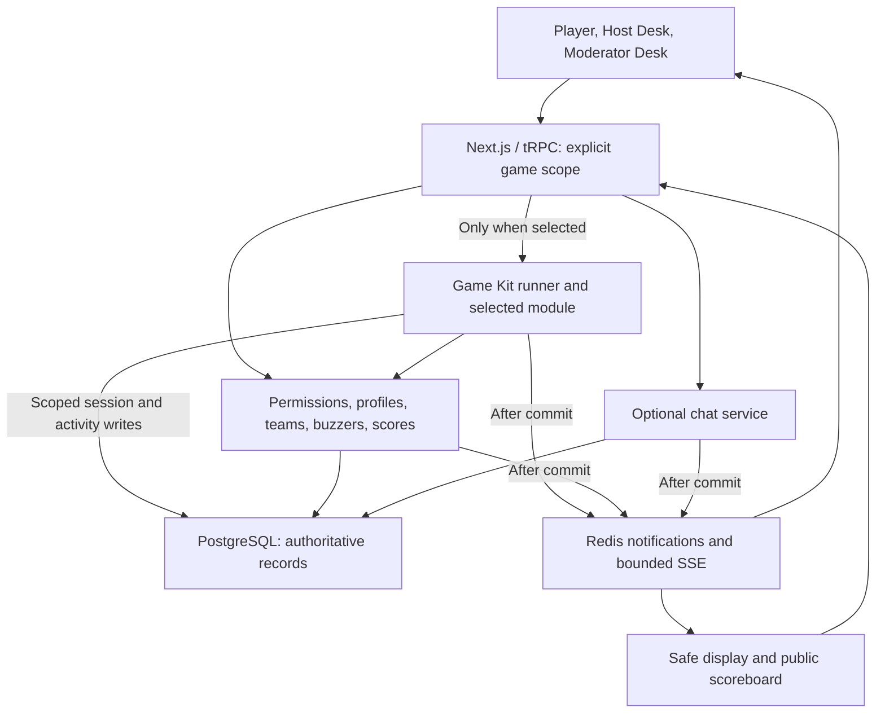
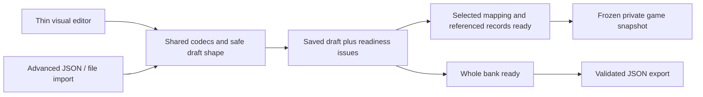
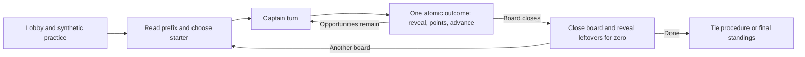

# Pride Trivia and Buzz Board - Architecture and Delivery Plan

> [!important] Planning only
> This document specifies future work. No Buzz Board implementation, dependency installation, infrastructure change, application test, or load test was performed for this revision. The review findings concern the plan; earlier repository observations were static, not runtime verification.

> [!note] Implementation status
> Implemented as stacked branches, with recorded evidence: PR01 rebaseline/toolchain/characterization ([PR01 baseline](./pr01-baseline.md)), PR02 migration baseline/explicit scope/topology spike ([PR02 baseline](./pr02-baseline.md)), PR03 shared score writer/receipts/effect evidence ([PR03 baseline](./pr03-baseline.md)), and PR04 durable buzzer claim/live streams ([PR04 baseline](./pr04-baseline.md)), which completes the corrected-core gate apart from a real backup-restore rehearsal. PR05 basic create/join/resume/lifecycle ([PR05 notes](./pr05-basic-ux.md)) and PR06 public Help/audience display ([PR06 notes](./pr06-help-display.md)) complete the code side of the basic release gate; a non-creator pilot and owner rights/licence decisions remain. PR07 helper roles/invitations/revocation is implemented ([PR07 notes](./pr07-helpers.md)). PR08 names/locks, guarded moves, removal, explicit account linking and guest recovery is implemented ([PR08 notes](./pr08-roster-identity.md)). PR09 chat storage/moderation/guards/retention and the scheduled cleanup command are implemented as a backend, off by default ([PR09 notes](./pr09-chat-backend.md)). PR10 live chat signals (content-free, current-access, coalesced, cross-instance) are implemented ([PR10 notes](./pr10-chat-live.md)). PR11 chat on the host desk and player page, moderation controls and the Chat Help article are implemented ([PR11 notes](./pr11-chat-ui.md)). PR12 mixed load runner, interlocks, operations runbook and local 100-bot evidence are implemented ([PR12 notes](./pr12-load-runner.md)): every correctness invariant holds at 100 bots, but the latency targets are not met on the 4-vCPU test machine (a recorded shortfall for owner review). PR13's review package (proposed Ranked Answers rules with executable worked examples, naming, privacy notices, rehearsal script and synthetic fixtures) is ready for owner review and **not approved** ([PR13 proposal](./pr13-ranked-answers-event-spec.md)); PR14 onward waits for its decisions, including the W23 handoff policy. Ahead of that approval, the owner asked for configurable points and turn rules for 3 to 8+ teams. The proposal now has four play styles for 2 to 50 teams, and a self-contained Ranked Answers mode implementing it is ready for a first event ([Ranked Answers mode](./ranked-answers-mode.md)), built directly rather than on the full Game Kit platform. Also added: dashboard game deletion and a fix for player tokens leaking to the dashboard; backup-restore rehearsal tooling with a recorded local run ([operations runbook](./operations.md#backups-and-restore)); and licence options ([licensing.md](./licensing.md)). For the first event, the owner also asked for: a cohesive UI with light and dark modes on every screen and layouts for phones, tablets and desktops at full and half width ([design system](./design-system.md)); opt-in **queued buzzing**; and **buzzer history with undo/redo**, separate from score history ([design](./buzzer-queue-and-history.md), Help article "Buzzing modes and undo"). The host desk is now Play / Ranked Answers / Players / Chat / Room. Ranked Answers rules are fully configurable and chosen when the game is created: six play styles (adding pass-along and buzz race), nine presets, and options for face-offs, passing, banking, steals, shared answers, race lockouts, miss penalties and a target score ([the rule space](./ranked-answers-rules.md)). A **Category Grid** mode (the plan's W15/PR25 module, text-only Question Bank v1, built directly like Ranked Answers) can also be chosen at creation ([Category Grid mode](./category-grid-mode.md)); a game runs one mode at a time. Ranked Answers gained an **Open answering** style (any team, any time) and a turn-order audit with randomised tests. The buzzer queue was hardened with randomised database sessions. Typed answers are explored, not built: the buzzer decides who answers, typing would only replace speaking, and the recommendation is to decide after the first event ([typed answers exploration](./typed-answers-exploration.md)). Since then: the **Game Kit** runner (PR14–PR18: one module recipe, receipts, stale-screen checks, a score-history barrier so the scoreboard's undo can't desynchronise a mode, and the W23 handoff, still the proposed default awaiting approval) with Ranked Answers and Category Grid moved onto it ([Game Kit](./game-kit.md)); **media** in questions (PR19: pictures, GIFs, audio and click-to-load YouTube by link; uploads, PR20, wait for owner approval); and **Sequential Quiz** with typed team answers (PR17 + PR26, [Sequential Quiz mode](./sequential-quiz-mode.md)). Then: optional **team captains** (W09/W16; off by default, automatic first-joined captain, reassignable by staff or the captain; [team captains](./team-captains.md)) and a **shared question library** in the grid and quiz editors (the PR21/PR24 library: search, uses, reuse across layouts, edit-once-changes-everywhere, no deleting a question in use, removing a placement keeps written questions). PR21/PR24 since: when another host saved first, editors offer **Keep mine / Use theirs / Download mine** instead of failing; a question's ID can be renamed with every grid tile and quiz position updated at once. A single editor shell with layout tabs isn't needed: a game runs one mode, each mode's editor shares the question library, and one exported bank carries both a grid and a quiz. Hosts' editors are single-column on phones (phones aren't a target for hosts). Upload widgets wait for PR20 approval. Owner decision: only formats for several teams are offered, so the two-team-only Classic style is retired and the TV format is kept as **Classic feud** for 3–8 teams; Category Grid is described as jeopardy style. A 10 / 100 / 1,000-user scaling study found and fixed four O(n²) live-update paths (whole player list in every update, joins re-sending state to everyone, joins triggering chat refetches, and every message re-fetching whole chat windows) and separates app limits from this machine's CPU limits ([load scaling](./load-scaling.md)). Everything else below is still proposed future work.

## Standalone implementation brief

**Project:** Buzz Board, a personal, open-source-ready web buzzer and scoreboard application.

**Audience:** the project owner and an implementation agent working in the Buzz Board repository without access to private notes.

**Revision intent:** apply a fresh senior-developer and host/co-host/moderator/participant critique, rather than accumulate another layer of promises. The integration layer is now **Buzz Board Game Kit**, shortened to **Game Kit**: the built-in contracts, scoped execution and UI seams for optional modes. It is not a separate product, package or plugin SDK. Ranked Answers, Category Grid and Sequential Quiz implement it; Quiz Maze remains a tiny extension test only.

**Status:** all behavior below is proposed future work. The persona register records decisions in the plan, not fixed application defects. The owner was unavailable to confirm the same-room fallback choice; its recommended one-way handoff is explicitly a **proposed default requiring review**, not an approved policy or implemented feature. The current backlog supersedes prior numbering and is provisional until repository rebaseline.
n

### Product invariants

1. **Buzz Board must always work purely as a buzzer and scoreboard.** Hosts may present slides, another website, documents, a whiteboard, or spoken questions however they choose. Basic use requires no question import, content pack, integrated board, or presenter wizard.
2. Team and individual formats remain first-class. Existing IDs, routes, participant credentials, scores, and manual score history must survive compatible upgrades.
3. Integrated Ranked Answers, Category Grid, and Sequential Quiz interfaces are independently optional per game. Their implementatio order does not require users to enable or play another interface.
4. Chat is independently optional and defaults off for migrated games and new basic games. A host can enable it during setup; enabling chat never selects an integrated interface.
5. Players can join as guests. Google/Discord sign-in is optional for players and must not silently replace their game identity. Creating games and accepting staff privileges require an authenticated account.
6. The creator remains the owner. Co-hosts have normal hosting authority without being able to remove/demote the owner or take ownership.
7. Moderators can manage chat, correct participant/team names, control self-renaming, and make permitted roster corrections. They do not get scores, buzzer administration, answer keys, or official-answer grading.
8. Public copy uses generic labels and original assets. This brief needs no employer system, private repository, participant list, or real question pack.
9. Deliver improvements in independently useful increments. A reliable small application is better than an unfinished general-purpose game/chat platform.
10. Casual hosts can author every shipped integrated format without writing JSON. Developers can import/export/edit the same JSON without conversion loss; there is no competing editor-only public format.
11. Public role-based help is part of the product. Users must not need the creator or this private plan to learn joining, hosting, moderation, or content authoring.
12. Initial managed uploads accept images/GIFs and audio only. Video is an approved embedded link, initially YouTube; no video-file upload or direct-video player in the new authoring contract.
13. Optional modes use Game Kit's documented built-in module contract. Shared hosting, authority, persistence, score/buzzer effects, recovery and layout are platform responsibilities, not copied into each mode.
14. Game Kit must not assume one linear sequence, one active question shared by everyone, or that every mode uses buzzers/official text responses. Quiz Maze is an extension-proof scenario, not a fourth promised release.
15. A failed decoder never silently changes control ownership. Any handoff to basic controls is explicit, authorized and audited, closes old mode acceptance, preserves the room/scores and establishes a score-history boundary.

**Reading guide:** the owner starts with the review register, feedback-application order and approval queue; use W01/W05/W13/W16/W23 for concrete journeys. The implementation agent follows the contracts, test groups and single PR backlog. End users get public Help and ordinary labels such as **Game mode**, **Team answer** and **Use basic controls**, not kernel/codec terminology.

### Vocabulary and document ownership

| Term                 | Meaning in this plan                                                                                                                                      |
| -------------------- | --------------------------------------------------------------------------------------------------------------------------------------------------------- |
| Room / event         | One existing `Game`: join code, roster, staff, chat and scores. A round is not another room.                                                              |
| Format               | Team or individual scoring. This is independent of the selected game mode.                                                                                |
| Game Kit             | Buzz Board's compiled-in optional-mode integration layer, formerly called the optional-game framework. Use this name in contributor docs and AI handoffs. |
| Mode                 | Ranked Answers, Category Grid or Sequential Quiz rules/presentation. Basic Buzzer & Scoreboard needs no Game Kit session.                                 |
| Content draft / bank | Private editable canonical JSON, exposed through a visual editor too. `questionBank` is shared by grid/quiz; `rankedAnswers` is a separate payload kind.  |
| Session              | A started mode's pinned identity, content/rules/version and runtime. Handing control to basic does not rewrite that identity.                             |
| Activity             | One opaque runtime board/clue/response window, game-wide or scoped to a scoring unit. Reusing an author question does not reuse its activity ID.          |
| Scoring unit         | A team, or an individual's existing backing scoring identity. It is not necessarily a participant or captain.                                             |
| Control ownership    | Basic core controls or the active Game Kit session, derived server-side. This is not an exclusive host/co-host lease.                                     |
| Frozen snapshot      | Definitions/rules, not a download or guarantee of external media bytes.                                                                                   |

The review register owns critique/disposition, workflows own user outcomes, contracts own technical semantics, tests own required proof, and the PR table owns dependencies. Do not copy complete permission/limit/rule tables between them. Game Kit is a working internal name, not a legally cleared new public brand; naming it does not require renaming stored mode IDs, existing routes or unrelated source files.

### Working labels and event assumptions

| Internal design key | Provisional public label | Descriptive helper copy                                                   |
| ------------------- | ------------------------ | ------------------------------------------------------------------------- |
| `manual`            | Buzzer & Scoreboard      | Run buzzers and track scores while presenting questions your way.         |
| `autocomplete`      | Ranked Answers           | Guess entries on a ranked suggestion board and reveal matches for points. |
| `categoryGrid`      | Category Grid            | Choose a clue from a category/value grid, then buzz and answer.           |
| `pubQuiz`           | Sequential Quiz          | Answer questions in order, submit responses, and let the host score them. |

Alternatives for later naming review: Suggestion Board / Autocomplete Challenge; Clue Grid / Pick a Clue; Question Rounds / Team Quiz. These are descriptive candidates, **not legally cleared names**. Check name availability and copy/asset rights before release. Provider names may appear for factual source attribution or login, not as branded game-mode names.

Use one public catalogue for labels, descriptions, supported formats and admission/availability, with separate server and lazy client registrations defined in the Game Kit contract. Do not rename stored IDs merely to change copy. If those keys have not yet been implemented, they are design identifiers, not a claim about the current schema. Basic creation stays first/default; unavailable optional interfaces are not advertised.

| Assumption             | Planning default                                                                                                                 |
| ---------------------- | -------------------------------------------------------------------------------------------------------------------------------- |
| Motivating event       | Pride-themed, approximately 40-60 remote attendees; real content authored later.                                                 |
| Meeting                | Proposed 60 minutes; date and final duration not confirmed.                                                                      |
| Motivating-event teams | Six; rehearse four, six, and eight. The generic new basic-room default is two, editable at creation. No elimination bracket.     |
| Operators              | One host can run it; a co-host and moderator make it easier, not mandatory.                                                      |
| Team collaboration     | Built-in team chat when enabled; a pre-arranged meeting/chat fallback if unavailable. Staff moderation access is disclosed.      |
| Audio/video            | Existing conferencing handles voice, captions, and screen sharing. No conferencing integration.                                  |
| Capacity               | Prove 100 bots using chat and buzzers together. A local 1,000-bot exercise is optional capacity research, not a product promise. |
| Privacy                | Team chat is private between teams, not from authorized staff; it is never an audience-display channel.                          |

## Fresh five-persona review and disposition

The previous draft was better structured, but still too easy to implement as a small platform before proving a useful game. Its most serious gaps were insufficient score provenance, ambiguous locking/retry semantics, and recovery/authoring workflows that could strand real users. More abstractions or another set of checked boxes would not fix those gaps.

This register replaces the historical F/R critique/checklist layers; their retained requirements are incorporated into the contracts below. **Blocker** means resolve/prove before the affected implementation is accepted, not a verified defect in the running app. **High** gates the affected release; **Medium** still needs its stated disposition. All decisions are planning dispositions, with future proof identified explicitly.

### Senior solo developer

| ID  | Priority | Blunt critique                                                                                                                       | Disposition and required proof                                                                                                               |
| --- | -------- | ------------------------------------------------------------------------------------------------------------------------------------ | -------------------------------------------------------------------------------------------------------------------------------------------- |
| D01 | High     | The plan repeats its own review and confuses documented intent with evidence.                                                        | One current register and dependency map; runtime gates remain unverified. T19/T24 check the actual journeys, not checkbox counts.            |
| D02 | High     | Generic row-write/effect plans can become the workflow engine the plan claims to avoid.                                              | Game Kit has a finite core-effect set and ordinary scoped helpers, not a persistence DSL. T20-T22 exercise real boundaries.                  |
| D03 | Blocker  | "Void/correct atomically" is hollow without immutable actual score deltas that survive history branching.                            | Extend the core operation's score evidence, preserve opening balances and compensate recorded effects once. T05/T21/T23.                     |
| D04 | Blocker  | Imprecise game/session locks and retry ordering can serialize all users, deadlock or reject an already-committed retry after finish. | Explicit mutation/lock matrix, acceptance versus response revisions and receipt-first reconciliation. T08/T21/T23 use real PostgreSQL races. |
| D05 | High     | Rolling-version orchestration is an unearned maintenance commitment.                                                                 | One reference topology, no active-event deployment by default, exact supported readers and tested maintenance/rollback. T16/T20.             |
| D06 | High     | Chat has retention; official answers, frozen content and score evidence largely do not.                                              | Data-class retention below; never purge active grading or dedupe needed for play. T07/T16/T21.                                               |
| D07 | High     | Selection/session flags can drift; an unavailable module can trap the room.                                                          | Pinned session identity is authoritative after start; basic handoff is an explicit separate control transition. T20/T23.                     |
| D08 | High     | Bots do not prove browser connection budgets, proxy streaming or affordable fan-out.                                                 | Browser/two-instance topology spike plus observed connections/fetches/deliveries/resource limits. T08/T15.                                   |
| D09 | High     | A registry is not proof that private data or legacy endpoints are safe.                                                              | Current-scope authorization, admission limits and synthetic canaries across HTML/bundles/API/SSE/cache. T01/T03-T04/T17/T21.                 |
| D10 | Medium   | "Single-source help" can quietly become another template language.                                                                   | Plain Markdown, one small manifest and fixed reusable fact panels; no executable articles/DSL. T19.                                          |
| D11 | High     | Basic usability waits behind chat, while many foundation PRs precede a real game interaction.                                        | Basic UX/help release first; an early action-to-display slice informs Game Kit before expanding it. T16/T24 and revised PR gates.            |
| D12 | Medium   | "Framework" and overlapping game/content terms make human/AI handoffs ambiguous.                                                     | Use Game Kit and the vocabulary above; preserve stored keys/routes. T19/T20.                                                                 |

### Host

| ID  | Priority | Blunt critique                                                                         | Disposition and required proof                                                                                                       |
| --- | -------- | -------------------------------------------------------------------------------------- | ------------------------------------------------------------------------------------------------------------------------------------ |
| H01 | High     | I cannot tell what to do next or which warnings really prevent Start.                  | Prepare-to-live overview, fix links, true blockers versus acknowledged warnings. W01/W13/W21, T24.                                   |
| H02 | High     | Synthetic-only practice does not rehearse my content; I might share the practice code. | Separate own-content preview, explicit practice copy and live room, with persistent labels. W02, T16/T24.                            |
| H03 | High     | An optional mode failure must not make 60 people rejoin another room.                  | Proposed one-way same-room **Use basic controls**, retaining roster/chat/scores and an undo boundary. W23/T23; owner review pending. |
| H04 | High     | "Choose captains" hides a pile of roster work and disconnect recovery.                 | Team-card badges, bulk first-eligible proposals and explicit paused repair; no presence election. W09/W14/W16, T06/T24.              |
| H05 | High     | Missing answers or 60 pending grades can make Finalize a click marathon or dead end.   | Missing is not empty text; bulk explicit resolutions, per-response grades and atomic finalize. W16, T14/T21/T24.                     |
| H06 | Medium   | Sharing the wrong window or hearing duplicate clips can spoil the event.               | Safe-display badge/preview and one deliberately activated meeting-audio source. W12, T12/T17/T24.                                    |

### Co-host

| ID  | Priority | Blunt critique                                                                          | Disposition and required proof                                                                                                       |
| --- | -------- | --------------------------------------------------------------------------------------- | ------------------------------------------------------------------------------------------------------------------------------------ |
| C01 | High     | An invitation drops me into the middle of a round with no briefing.                     | Desk overview shows phase, pause reason, outstanding work and recent authorized actions. W03-W04, T10/T24.                           |
| C02 | High     | "Export mine as JSON" is not recovery for a casual editor.                              | Early newer-revision banner and **Save as new draft**, preserving work without silent merge/selection. W13/W19, T18/T24.             |
| C03 | High     | Two helpers should not fight stale buttons or need a controller lease.                  | Pin pending actions to their activity, keep input and show who committed; scope independent grading separately. W04/W16, T10/T21.    |
| C04 | High     | Revocation cannot leave my private desk looking live or sign me out of unrelated games. | Game-scoped role-change UI, stream/cache/recovery invalidation and server denial. W03/W18, T01/T08/T18.                              |
| C05 | Medium   | Staff entry, playing and private preview look too interchangeable.                      | Explicit desk/player/preview contexts; no forced player join or known-staff competition in integrated presets. W03/W06/W21, T01/T11. |
| C06 | Medium   | "Co-host" grants a lot more than helping with chat.                                     | Plain authority summary on invite/acceptance; moderator offered for narrower work; owner exceptions clear. W03, T04/T24.             |

### Moderator

| ID  | Priority | Blunt critique                                                                     | Disposition and required proof                                                                                                    |
| --- | -------- | ---------------------------------------------------------------------------------- | --------------------------------------------------------------------------------------------------------------------------------- |
| M01 | High     | I cannot watch six team tabs and game chat effectively.                            | Bounded merged recent feed, channel tags/filter and the same existing chat transport. W10, T07-T10/T24.                           |
| M02 | High     | Waiting for a paused round before stopping an abusive user is unacceptable.        | Ejection/revocation is immediate; moves/captain repair remain guarded; preserve prior winner/points. W09, T06/T21.                |
| M03 | Medium   | Remove, clear, mute and eject have different consequences that need clear targets. | Exact channel/actor labels, bulk/eject confirmations, quick unmute/edit/unlock and irreversible-redaction notice. W10, T09/T24.   |
| M04 | High     | I need target authority, mute expiry and rename locks before acting.               | Server-derived target card/protected-role checks; player ejection never removes staff authority. W08-W10, T01/T07.                |
| M05 | Medium   | A desktop-only console or a new ticket queue would both be bad.                    | Phone-first feed/search/action menus and derived organizer-attention badges; meeting handoff for blocked moves. W09-W10, T09/T24. |
| M06 | High     | A removed body or offensive name must not linger in pins, feeds or retries.        | One current projection/redaction path; private bodies fetched under current ACL, not stale fan-out. T02/T07-T08/T12.              |

### Participant

| ID  | Priority | Blunt critique                                                                    | Disposition and required proof                                                                                                     |
| --- | -------- | --------------------------------------------------------------------------------- | ---------------------------------------------------------------------------------------------------------------------------------- |
| P01 | High     | Who is captain, and does "my answer" mean my team or just my phone?               | Clear captain badge; team members read their unit's saved response/status, captain edits, individuals self-only. W05/W16, T06/T14. |
| P02 | High     | A chat guess or unsaved draft can look like an official answer.                   | Distinct composers and draft/sending/acknowledged/closed states with same-ID reconciliation. W11/W16/W18, T09/T14/T21.             |
| P03 | High     | Self-switching teams must not bypass the active-round guard imposed on staff.     | Same lifecycle/window guard for all moves; first assignment/resume remain separate. W05/W07/W09, T06.                              |
| P04 | Medium   | Chat on my phone hides when buzzing opens; stealing focus is not a fix.           | Live-state strip and one-tap return, real keyboard/focus/reduced-motion testing. W11, T09/T24.                                     |
| P05 | High     | Device changes, Sign out and Leave room can destroy my apparent identity.         | Explicit consequences, stable server profile and guided login/recovery; no new self-transfer service in MVP. W06, T03/T11.         |
| P06 | Medium   | "Chat off" can mean five unrelated things.                                        | Separate availability, posting policy, personal panel layout and my mute, each with a reason. W11-W12, T09/T12.                    |
| P07 | High     | I should know who can see my team's chat/answer and what remains after the event. | Concise visibility/retention notice and scoped browser cleanup; no remote-recall promise. W06/W11/W16, T03/T07/T18.                |
| P08 | Medium   | A wrong tab, duplicate name or reconnect must not look like successful play.      | Room/practice/team/role identifiers and text/icon buzz/response outcomes. W01/W05/W18, T05/T11/T24.                                |

### Step-by-step application of the feedback

1. **Consolidate and name:** replace historical review/checkmark layers with this register, define Game Kit/vocabulary and retain one authoritative contract/backlog per subject.
2. **Bound the architecture:** keep a static typed module boundary, finite core effects and an early vertical slice; remove any implication of a generic persistence/workflow/plugin platform.
3. **Close the data-correctness gaps:** specify immutable core score effects, receipt retry semantics, resource-scoped concurrency, version support and data-class retention before accepting new writes.
4. **Design failure as a normal workflow:** separate pause/resume, normal correction, same-room basic handoff and finish/reopen; preserve identities/scores and prohibit silent resets.
5. **Repair organizer journeys:** prepare/preflight, own-content practice, captain setup, safe display/audio, co-host orientation, safe draft forks and low-click grading.
6. **Repair moderation/participant journeys:** merged tagged moderation, immediate ejection, safe moves, team-response ownership, explicit posting/submission states and phone-first recovery.
7. **Preserve authoring/interchange/help:** retain both canonical payloads, selected/full readiness, lossless visual/JSON interchange, image/audio uploads, embed-only video, measured editor budgets and one-source help.
8. **Rebuild delivery and proof:** release useful basic UX/help before chat, validate Game Kit through real core integration, keep adapters independent and map every finding to workflow/test/PR evidence.
9. **Adversarial final pass:** verify every correction/fallback/role transition against the data model and graph; leave actual runtime/usability measurements and policy approvals explicitly unverified.

### Scope that will not quietly grow back

MVP includes guest play, optional player sign-in, helper invitations, co-host parity, name/team moderation, simple chat, responsive layouts, safe displays, role-based help, and the mixed workload. Each integrated format's casual release also needs its thin editor; the JSON-only milestone is a developer preview, not that release.

Game Kit is a small in-repository composition boundary for these modes, not a public plugin SDK. Design lifecycle, activities, effects, projections and versioning first, then prove an early real vertical slice before expanding the abstraction. Do not build a graph editor/engine or actual Quiz Maze game merely to demonstrate extensibility.

Defer direct messages/chat attachments, rich-text/WYSIWYG question canvases, drag-and-drop dependencies, collaborative cursors/CRDTs, global editor history, message restoration, archival chat/search, read receipts, presence promises, AI judging, permission builders, enterprise identity, plugin SDKs, tournaments/playlists, arbitrary game rewind, direct-video files/transcoding/proxying, and multi-provider deployment parity. Thin forms are in scope; a general CMS or editable end-user wiki is not.

One pinned announcement per channel and clear-visible-history are small useful controls. A full reporting/ticket queue and raw-chat export UI are not required for the first event. Provide organizer contact instructions instead of inventing a private messaging subsystem.

## Role and identity contract

Public role name **Co-host** maps to the existing admin concept. Prefer extending the existing `GameAdmin` membership with `admin`/`moderator` roles rather than creating a parallel membership system. The owner is derived from `Game.createdById`, never from an editable client flag.

| Capability                                                       | Owner                              | Co-host            | Moderator                   | Participant                                                                     |
| ---------------------------------------------------------------- | ---------------------------------- | ------------------ | --------------------------- | ------------------------------------------------------------------------------- |
| Run settings, teams, buzzers, scores, and enabled interfaces     | Yes                                | Yes                | No gameplay controls        | Own eligible player actions only                                                |
| Read answer keys and grade official responses                    | Yes                                | Yes                | No                          | Current team's saved response/status, or own individual response; no hidden key |
| Stop an integrated mode and use basic controls                   | Yes, proposed confirmed handoff    | Yes, same proposal | No                          | No                                                                              |
| Invite/remove co-hosts or moderators; change staff role          | Yes                                | Yes, except owner  | No                          | No                                                                              |
| Remove/demote owner, transfer ownership                          | Not in MVP                         | No                 | No                          | No                                                                              |
| Permanently delete event                                         | Yes, confirmed and safe-state only | No                 | No                          | No                                                                              |
| Reissue access for a verified unlinked guest profile             | Yes                                | Yes                | No                          | No                                                                              |
| Rename participant/team display names; lock/unlock self-renaming | Yes                                | Yes                | Yes                         | Own allowed name; current team's allowed name                                   |
| Move a player between existing teams                             | Yes, guarded                       | Yes, guarded       | Yes, guarded                | Self-switch only when allowed                                                   |
| Create/delete teams or change roster-wide settings               | Yes                                | Yes                | No                          | No                                                                              |
| Read game/team chat for moderation                               | All channels                       | All channels       | All channels                | Game + current team only                                                        |
| Remove a visible message; pin/unpin; lock chat; set slow mode    | Yes                                | Yes                | Yes                         | No                                                                              |
| Chat mute/unmute                                                 | Other actors                       | Non-owner actors   | Ordinary participant actors | No                                                                              |
| Clear visible room history                                       | Yes, confirmed                     | Yes, confirmed     | Yes, confirmed              | No                                                                              |

Content moderation is not role removal: a moderator may remove a staff message without gaining that staff member's authority. No moderation action removes owner capabilities. Deployment limits, retention policy, and billing approval are not game-role permissions.

Staff are trusted organizers with cross-team visibility. Known staff accounts do not compete in the planned integrated presets; a player route is not an answer-key bypass for a moderator. This cannot identify a staff member secretly using an unrelated guest identity. Do not break existing basic-game participation merely because an authenticated organizer also has a player profile: **pressing one's player buzzer is distinct from administering all buzzers**. A captain is a current same-team participant, not a staff role.

### Authentication rules

- Only configured Google/Discord login buttons appear. At least one host/staff provider must be configured for normal production administration; players may still use guest credentials.
- Guest play uses the existing game-scoped participant credential. Staff authority requires a valid authenticated account plus current game membership/ownership; a participant token alone is never a co-host credential.
- Player sign-in links an unowned/currently-owned guest profile only after ownership checks. Preserve its ID, chosen name, team, scores, chat identity, and rename locks. Never overwrite an alias with the provider name on login.
- If the account already has a different profile in this game, offer resume-existing or continue-as-guest. Do not silently merge profiles, move points, or bind a guest token to a different account.
- On another device, a signed-in player can resume an unambiguous linked profile. Multiple legacy profiles require explicit selection. An unlinked guest who lost the token uses the verified organizer-assisted recovery flow below, not automatic person recognition.
- Staff can open the host/moderator console without first joining as a player. Staff chat uses a server-derived staff identity and a game-scoped alias; participant chat uses its `GameUser` identity. Provider account names/emails are not game-profile editing targets.
- Unchosen staff aliases start with a neutral Organizer label too; never publish a provider name merely because the account accepted a role. Role badges come from the server, not an alias such as "Host".
- Name locks apply to participant game profiles and team-member edits. Staff can edit their own game-scoped alias; owner/cohost can correct organizer aliases. These are not OAuth account edits, global account locks, or a moderator role-grant shortcut.
- Every server operation receives an explicit game/resource scope. Route/header game identity wins over incidental "last game" cookies, and mismatches fail clearly. Scope client providers, tokens, and query keys per game so two tabs do not control the wrong event.

## Workflow acceptance catalogue

These are design requirements for future implementation, not application tests already passed.

### Organizer and co-host

**W01 - Create and share a basic game**

- Landing/navigation always exposes Join, Host, and Help, regardless of account state. A host signs in and gets one short create form: suggested editable name, team/individual format, and a team-count stepper only for team games.
- Basic defaults are Buzzer & Scoreboard, chat off, two initial teams and automatic assignment for a new team game. The motivating event can choose six; individual games hide team controls. Optional presentation/content is an explicit choice, not a mandatory wizard.
- Creation atomically creates the initial teams/scoring setup and returns a lobby with Copy join link/code, QR, Open host desk, Open audience display, and Helpers. A duplicate creation request returns the same game rather than charging ahead with a second room.
- A compact "Share this window, not the host desk" audience-preview cue and contextual quickstart replace a tour users must dismiss. Advanced settings remain available, not another onboarding screen.
- Repeated submission/slow response cannot create duplicate games. Invalid code/closed joining gives a specific recoverable message, not a retry loop.
- The lobby is the preparation overview: Room/code, Basic or selected mode, teams/captains if relevant, Content, Preview/Practice, Helpers and Start. Show one next recommended action, not Game Kit terminology or a mandatory multi-page wizard. Existing basic Listen still works directly.

**W02 - Edit setup, duplicate, and practice**

- Before start, change settings/team labels and select an optional interface if desired. Changing format requires no players and no gameplay/score edits; the initial empty score snapshot alone must not make a new draft uneditable. Otherwise create a new game.
- Interface selection checks its declared format support and preserves previous private drafts. After start, identity/content/rules stay pinned. Another integrated mode requires a new/duplicated game; W23's explicit basic handoff is a different operation, not identity replacement.
- Duplicate copies approved settings/team labels/content draft, **not** players, tokens, chat, scores, or staff grants. The creating account owns the duplicate; show that explicitly.
- **Private preview** checks the host's own selected content/layout and permitted player/display appearance without changing gameplay. **Practice copy** creates a separate clearly labeled game/code with the chosen own-content copy or a synthetic starter and zero scores. **Live room** retains its original code/data. Persistent room/practice banners distinguish all three.
- Practice does not copy players, credentials, chat, responses or staff grants. The creator owns the copy; invite helpers explicitly. Use the normal guest flow on another tab/device for a practice player, not a production auth bypass or a new bot-management feature. Hosts can choose fewer practice teams before joining.

**W03 - Add helpers before or during an event**

- Owner/co-host opens **Helpers -> Invite -> Co-host or Moderator -> Copy link**. No email service or prior player-roster membership is needed.
- Show a plain authority summary before inviting/accepting: co-host can run the event, score, see keys and manage helpers; moderator handles chat/names/guarded roster work. Owner-only deletion and protected owner authority are explicit. Do not add a custom permission builder.
- Link previews/GET requests do not consume it. The invitee sees game/role, signs in if needed, confirms the account, and explicitly accepts.
- Default invitation expires after 24 hours, is single-use, hashed in storage, and revocable. Repeating redemption by the same account is idempotent; a different account cannot reuse it.
- This is a bearer invitation: anyone holding it can accept the stated role before use/expiry, so share it privately. Recheck expiry/role/grant authority after OAuth return, not just before redirect.
- An existing equal/higher role is not silently downgraded by an invitation. A consumed invitation retry reports current status and never re-grants membership that staff subsequently removed; role changes require the explicit helper-management path.
- Expired/revoked/used links give a clear explanation and request-new-link path. Show who accepted and allow removal/role change immediately.
- Co-host can perform ordinary host work and invite other helpers while the owner is busy. Neither UI nor direct API can change owner authority.
- Dashboard membership means owner **or an existing staff membership**, not a predicate requiring every staff row to belong to the current user. The owner and each co-host/moderator must see their own correct game entry.
- An accepted helper lands on the appropriate desk with current phase, pause/reconnect reason, captain/grade attention and recent permitted actions. Revocation/demotion replaces controls with a game-scoped role-change notice, closes old private access and clears that scope's recovery/cache; it does not sign the account out of unrelated rooms.

**W04 - Host together without fighting the interface**

- Host Desk keeps buzzer/score or current mode controls visible while chat, roster, and helpers open in side panels. Co-host gets the same operational screen; owner-only event deletion is separate.
- Name/chat/helper activity must not invalidate a pending score action. Competing gameplay actions use guarded revisions/idempotency: reject stale actions visibly, keep the user's draft input, show who last changed state, and never auto-retry a different scoring action.
- Routine score increments are quick; bulk set/clear/finish actions show scope/count and confirmation. Undo/redo availability explains why a command is unavailable.
- A bounded Recent actions panel shows the latest ten authorized operation summaries, current actor aliases and outcome/score counts, not question/chat bodies or a second event log. Moderator summaries exclude gameplay/private-answer information.
- Keep live operation and private content preview clearly labeled. Shared state changes cannot redirect a pending click to the next board/clue. Human handoff uses this briefing/recent context and the meeting; no exclusive controller lease or collaborative presence system.

### Participant and identity

**W05 - Join, select a team, and resume**

- A shared link pre-fills the code; otherwise enter the code and nickname on one screen. Join as guest is primary; Google/Discord is secondary and never necessary to play. Do not publish a provider account name without the player's choice.
- New team games default to transactional balanced assignment to existing teams, showing "You're on Team X" and Change team when allowed. Hosts may choose player-selection or staff-assignment policy; preserve the existing policy for migrated games.
- `freezeTeams` prevents later self-switches, not policy-based first assignment or credential resume. Automatic assignment is idempotent, uses current eligible roster counts, and never rebalances returning players. A race of joins must not assign everyone to one team.
- When staff assignment/no available team prevents play, show that reason and organizer contact/help. Otherwise go straight to Ready/Waiting for host/Buzzer open, not a separate profile-management tour.
- Refresh/reconnect resumes the same valid profile. A failed auto-join stops automatic attempts and offers an explicit retry; no infinite effect/mutation loop.
- Individual format has no team selector and no one-person team-chat tab, even if internal scoring uses a backing team row.
- A valid existing credential offers Resume with the current alias/team; using a different identity is explicit. Buzzer disabled states explain host-closed, team-rejected, unassigned, or reconnecting status, rather than appearing broken.
- Show room/practice identity, alias/team, captain where relevant and the next permitted action. Team members can see their unit's current official response/status; only the selected captain can edit it. A live late join to an existing team does not add a new scoring unit to the current activity.

**W06 - Sign in later or switch device**

- Google/Discord login preserves the current guest game profile and user-entered drafts where possible. Linking failures leave the existing profile intact.
- Handle account/profile conflicts explicitly, and never silently attach another person's game token to the signed-in account.
- Staff invitations, player login, and guest resume all return to the correct game. **Sign out** clears account-related browser game credentials/private caches/recovery and explains that linked profiles can be resumed after login. **Leave this room on this device** clears only that room's credential/private cache, with a warning for an unlinked guest. Neither deletes the server profile/score or creates a replacement automatically.
- For a lost **unlinked guest** credential, owner/cohost verifies the person through the meeting, selects **Recover guest access**, and privately shares a single-use 15-minute resume link. Atomic explicit POST redemption rotates the credential and revokes the old one, preserving profile/team/scores/names/locks; merely generating a link does not cut off a still-working device.
- Reuse invitation storage with a distinct recovery purpose/target, not a second recovery service. Recovery cannot grant staff authority, resume another game's profile, bypass a linked OAuth account, or readmit an ejected profile. Expired/used links explain how to request another; do not log/copy secrets into public chat.
- Recheck guest/link/token-version status at redemption. A used bearer link alone cannot reissue a credential to another browser; an authenticated current-credential retry can show status. If delivery of the new credential itself was lost, verified staff issues another link rather than inventing a success or duplicate profile.
- Before changing device, explain optional account linking/resume or organizer-assisted recovery. A new self-service token-transfer/QR system is deferred; never reuse the public join QR for a private resume credential.
- Same-room tabs share that browser's credential; leaving/rotating it affects those tabs. Other rooms keep their separate scopes. A role change is not a global account sign-out.

**W07 - Edit personal/team information**

- A clear **My game profile** action edits the game alias, not the OAuth account. Show the current team, name-policy status, and permitted team-name edit.
- Any current team member may rename the team while `allowMemberRename` is true; no captain system is required for basic games.
- Locks explain who controls the change and how to contact staff. A denied save preserves the typed draft. Team-switch lock, own-name lock, and team-name lock are different controls.
- Duplicate aliases remain distinguishable by team number/short profile ID in management views; do not add a uniqueness migration merely to reject duplicate names.
- Self-moves obey exactly the same active-buzzer/activity guard as staff moves, even when `freezeTeams` is false. Basic play with buzzing closed may permit a move; a live integrated activity requires pause/closed acceptance and captain repair. First assignment/resume is not a later self-switch.

### Moderation and roster

**W08 - Correct an inappropriate name and stop rename evasion**

- Owner/co-host/moderator finds the person/team through roster search or a chat author menu, opens **Rename**, enters a replacement, and can select **Lock further self-renaming** in the same save.
- Per-user `allowSelfRename` and per-team `allowMemberRename` persist for the same resumed/linked profile through refresh, login, and another device. A fresh anonymous identity is not the same person-level identity; closing joining and staff assistance handle that limitation. Unlock is a visible staff action.
- Staff rename + lock is atomic. A participant saving an older draft receives a conflict/locked explanation instead of overwriting the moderated name.
- Current name changes reach roster, team info, chat author headers, independent scoreboard, and optional displays. Individual player rename also keeps its backing score label consistent. IDs and points do not change.

**W09 - Fix team assignment or remove a participant**

- Authorized staff can move a participant to an existing same-game team or unassigned state. Scores stay with their original scoring unit; no historical point transfer.
- A move cannot race an open buzzer window. Host/co-host can close/pause then move; a moderator sees the reason and can move once safe. For a live integrated question, pause first and repair/replace a moved captain before resuming.
- Team moves atomically update eligibility and remove old team-chat access/cache. A past buzzer winner retains the team it represented at claim time.
- In individual format, team-move/rename-team controls are absent and corresponding APIs reject them. Do not merge individual scoring units by moving a profile.
- Delete an unused empty zero-score team only with confirmation. After use/history, retain the team and explain the restriction; team archival/complex redistribution is deferred.
- **Eject** immediately revokes player credentials/eligibility even during an open window; it must not wait for a routine move guard. Never erase a previously committed winner/score. A pending captain loss flags Needs organizer action and blocks that unit's new official writes until repaired; it does not silently forfeit the team.
- Captain controls are on team cards. Offer a bulk **Suggest first eligible captains** proposal using stable join order, then explicit Apply; host/co-host can choose another member. Show everyone the selected captain. No automatic election or online-presence claim on disconnect. Reassignment during a live activity requires pause/closed acceptance; the saved response belongs to the unit, not the former captain.
- A blocked moderator move explains the needed host action and offers a copyable meeting handoff; derived missing-captain/eligibility badges are visible on Host Desk. No new request/ticket queue is required.
- Staff removal is separate from player ejection. Server-derived target role/identity makes that scope clear; chat mute protection cannot be bypassed by a linked organizer's alternate player persona. Closing joining limits anonymous re-entry, but cannot promise a person-level ban.

**W10 - Moderate chat without leaving the event**

- A message/author menu offers Remove message, Mute/Unmute, Rename participant, and current lock status where authorized. Team headers expose Rename/Lock. Moderator Desk has chat and a minimal roster, never the answer key.
- Remove redacts the message body and displays a tombstone. There is no restore-deleted-text feature in the MVP; the deliberate menu action is the confirmation, not a modal for every routine message.
- Quick mute defaults to ten minutes, with an until-unmuted choice. It is game-wide chat-only; it does not block buzzing, official responses, scores, or local audio.
- Pin one announcement per channel; game-channel staff-only mode keeps guesses out of public discussion during a round. Clear visible history requires confirmation and is not permanent backup erasure.
- Reasons/audit are staff-only. No mandatory long free-text form for routine corrections; log actor, target, operation, time, and a short reason category.
- Moderator Desk defaults to **All recent channels**: a bounded merged view over existing messages with Game/Team tags, filters and jump-to-channel context. Initially 100, at most 200 merged recent entries; this is not archival search or a reporting inbox. It reuses the same authorized stream/query service, not another `ChatEvent` table or connection.
- Every menu identifies the actor, server-derived role, channel and current mute/rename lock. Clear/pin requires an actual channel target, never an ambiguous all-channel operation. Mute displays server-based remaining duration and quick Unmute; rename offers Edit/Unlock. Removed bodies remain unrestorable, with that consequence in the action copy.
- Routine mute/remove needs at most menu-open plus action; rename-and-lock at most menu-open, Rename, Save after text entry. Eject/clear adds deliberate confirmation. Test keyboard-equivalent controls, not hover-only menus. Pins, merged feeds and retries must all show current redaction/name state.

### Chat and displays

**W11 - Use chat on desktop or phone**

- Desktop uses a familiar collapsible live-stream side-panel pattern, with original styling. Collapse retains unread indication and draft; reopening does not steal focus or scroll away from a user's reading position.
- Mobile uses a chat sheet/tab with an obvious one-tap **Back to game/buzzer**. Do not promise a full keyboard, chat history, and large buzzer can all fit simultaneously on a small phone.
- Enter sends, Shift+Enter adds a newline, and a visible send button is available. Global buzz shortcuts do not fire in inputs/contenteditable fields.
- Preserve unsent text. Sending/saved/failed states are distinct; retry the same operation ID/content, not a new duplicate. After a long outage, explain that only the recent window was reloaded.
- Hiding a panel does not disable chat or mute anyone. A host-provided default never removes a participant's ability to collapse their own panel.
- The chat view keeps a live phase/eligibility strip and obvious game-return action, including while the phone keyboard is open. Never auto-focus, close someone's draft or fire a global buzzer shortcut from an input to announce a phase change.
- Distinguish **Chat disabled by organizer**, **Only organizers can post here**, **You are muted until...**, **Slow mode**, and **Panel hidden/collapsed**. Layout `off` means hidden, not disabled. A muted player can still buzz/submit when otherwise eligible.
- Before first posting, show concise team-history/staff-access and game-chat audience notices with Help details. Use text/icons for accepted/failed/closed states and local sound preferences; do not announce every incoming message through a screen reader.

**W12 - Choose scoreboard/presenter chat layout safely**

- Host/co-host separately chooses the default participant chat layout and the authenticated audience-display layout: **off, collapsed, or open**. These are layout preferences, not posting permissions.
- Apply the same chat-panel component to the standalone authenticated scoreboard and optional interface display. Always keep controls/answer keys outside the safe display projection.
- Public/unjoined scoreboard URLs remain chat-free in the MVP. To screen-share chat, use the authenticated safe display and explicitly choose **game channel only**. Team channels, moderation reasons, helper links, and private notifications are never display options.
- Show participants a clear notice/badge when game chat may be shown to the meeting audience. Staff can preview the exact safe display before sharing; opening it never mutates gameplay.
- Per-game display defaults are shared between host/co-host; personal collapse state stays local to its view/game. A public chat feed without joining would be a separate privacy feature, not an accidental consequence of opening the panel.
- The separate read-only display has a persistent **Audience display** label, room/code and practice banner if applicable. A preview shows exactly this projection. Designate one shared-display browser for meeting audio; all other previews start muted/click-to-play and never autoplay on every device.

### Optional content, live games, and recovery

**W13 - Create and revise optional content**

- Only a selected interface needs content. Casual hosts use its visual editor; Advanced JSON supports paste/file import, schema help, apply, read-only preview and export over the same model. The earlier JSON-only milestone remains a developer preview.
- Draft saves accept bounded, known-shape incomplete work and label it **Saved draft, not ready**. Syntax/type/unknown-version failures never replace the working/server draft. Save, readiness, media availability, and publishing are different states.
- Co-host can edit the same draft. Version conflicts keep local work and offer reload or export/copy; no silent overwrite or collaborative editing system. Temporary recovery is scoped to account/draft and cleared on logout/role loss.
- A newer saved server revision produces a non-destructive stale-draft banner before Save where possible. On conflict, offer **Save my work as a new draft** while still authorized, as well as reload/export. A fork does not silently replace the selected draft or frozen live content; select/preflight it explicitly. No merge engine or edit lease.
- In a started room, label **Editing a draft; live content is frozen** and link the played snapshot separately. A normal Save is never a live wording/rule change. Duplication names its source explicitly: latest saved draft or the supported played snapshot, never an invisible mixture.
- Category Grid and Sequential Quiz share Question Bank v1 below. Questions live once in the pool; layouts reference IDs. Unused pool entries are allowed and shown as informational counts, not validation failures.
- Starting validates/freezes the selected mapping and referenced ready records, with source draft revision/hash. Unused unfinished draft questions/layouts do not block that game and are not copied into the audience/runtime payload. Full-bank validated export has its own stricter readiness check.
- Image/GIF/audio controls offer UploadThing upload when configured or a URL. Video is a supported embed link only. Returned URLs populate the canonical media record; the host need not manipulate JSON.
- A paused game's prompt wording may use an audited display-only correction; answer IDs/ranks/points stay frozen. Broken question media permits retry, an explicit original-link action, or the selected module's declared skip/void/continue action. Arbitrary live question substitution is deferred; predeclared Ranked Answers spare boards remain part of that separate ruleset.
- Preflight groups **Blocking** shape/reference/required-roster issues with links to the exact editor/team field, **Warnings** for media/accessibility/manual fairness checks, and ordinary information. Start never bypasses blockers. Hosts can acknowledge warnings under the event policy; a server cannot certify rights, playback or fairness by checking a URL.

**W14 - Run Ranked Answers and correct mistakes**

- Preflight validates nonempty active teams, captains, board lengths/weights, source metadata, and the selected content. Team count determines rotation, not a hidden two-team assumption.
- One action accepts/reveals/awards/advances; separate miss/duplicate/pass/timeout actions award zero. Leftover reveals award zero.
- Both host and co-host can operate it. Supported latest-result correction auto-pauses and atomically changes paired state/core effects; chat, names, helpers and moderation are not undo targets. Never hide an already disclosed answer again; an accidental hidden-row reveal marks the board compromised and offers explicit void/reserve rather than replaying that opportunity.
- No arbitrary cross-round rewind or integrated redo engine is required for the first release. Keep existing manual score undo/redo intact. Explain that revealed information cannot be made unseen.
- On refresh/restart, show the committed board/score state. Do not restart a timer or award points from a client animation.

**W15 - Run Category Grid**

- Host/co-host opens an unused clue chosen by the selecting team/person, reads it, then deliberately opens buzzers. Host judges, applies the configured score effect, and returns to the grid.
- Wrong answers can lock out that scoring unit for the clue; penalties are explicit configuration. A fresh clue resets the correct eligibility.
- Support team and individual formats using existing scoring units. A chat mute is not a buzzer lockout. Selection/used-cell/scoring changes commit together.
- Read grid columns/cells from the shared bank mapping. A closed tile shows its configured label/points, not a question thumbnail, answer, media URL, or hint-bearing author ID.

**W16 - Run Sequential Quiz**

- Teams submit through a selected captain; an individual submits for their own scoring unit. Chat messages are not official answers.
- Responses may be replaced until the question is locked. All current team members read their team's acknowledged response/status, but only the current captain edits it; an individual reads/writes only its own unit. Distinct teams' submissions do not compete for a global gameplay revision; lock/finalize serializes against them.
- Host/co-host sees received/missing counts, locks, grades, then finalizes answer reveal and score effects once. Group identical normalized answers for efficient marking; explicitly mark remaining answers incorrect rather than silently treating ungraded rows as final.
- Co-hosts can grade different responses without a global revision conflict; competing edits to the same response show a local conflict. Group marking checks the affected response revisions and never silently overwrites another grader's work.
- A moderator cannot see private official responses or grade. A muted captain can still submit. Warn that individually grading 40-60 unique free-text responses can dominate the meeting; team play is the recommended large-event format.
- Resolve the ordered question-ID list against the same bank used by Category Grid, with the same question/media renderer. Question content is not duplicated into a second mode-specific format.
- Label a separate **Team answer** or **Your answer** composer with explicit Save/Replace; Enter in chat is never an official submission. Local draft, Sending, Received at revision/time, Replaced, Failed and Closed-before-save are distinct. Only a server acknowledgment counts as received; failed/closed text remains recoverable locally without appearing submitted.
- No response is not an empty-string answer: empty/whitespace-only text stays a local draft and cannot receive a saved acknowledgment; retain original nonblank text for grading. Show received/missing/pending-grade counts and bulk **Resolve remaining as incorrect/missing** with scope/count. Materialize a missing grade explicitly, never a fake submitted blank. Grouping is a marking aid with originals/individual overrides, not automatic judging.
- Finalize requires an explicit disposition for every frozen unit, including missing ones. Ordinary assisted text entry obeys the same open window. During grading, a host may explicitly mark an unsubmitted unit's result with a connectivity-assistance reason; retain the staff actor, do not fabricate submitted text/time or increase the received count. This is a manual grade, not a late participant response.
- Skip/void before finalize keeps audit/status and awards nothing. Raw response is private to current unit members and host/co-host; grade stays hidden until finalize/reveal, when the unit may see its own result and the correct answer, never other teams' submitted text.

**W17 - Finish, reopen, and reuse**

- Finish confirmation summarizes unresolved buzz/question state, closes normal joining/playing, and makes participant chat read-only. Co-host can finish as well as the owner.
- Within 24 hours, an authorized host/co-host can deliberately reopen to correct results; never automatically restart buzzers/timers. After that, duplicate a new game rather than resurrecting an expired session.
- Completed results remain readable. Retention removes chat bodies/audit metadata according to policy, not scores via an unrelated cleanup.
- Participant self/team-name editing becomes read-only after finish. Staff may still correct an inappropriate final alias without reopening scoring or chat.
- Duplicate/practice do not copy credentials, chat, private responses, or helper grants. Only the owner can permanently delete an unstarted empty draft or finished event, with game-name confirmation; running/paused games cannot be deleted. Do not use deletion as the normal reset flow or promise instant backup erasure.
- Normal finish/reopen invokes the selected module through Game Kit, closing its activities without silently grading responses, awarding points, reopening buzzers or restarting timers. An unsupported version offers safety pause and the explicit W23 basic handoff, never automatic conversion. A handed-off room finishes/reopens through basic controls only.

**W18 - Multiple tabs, disconnects, and partial outages**

- Opening another game/helper invite must not change the first tab's game scope or token. Every mutation names the intended resource/game.
- A Redis outage shows live-sync failure and prevents unbounded chat writes; healthy DB-backed score/buzzer commands can still commit and be reconciled. A saved command is reported as saved with a sync warning, never falsely "unsaved" or retried under a new ID.
- A database failure cannot produce an accepted buzz/message or fake score. Preserve drafts and show explicit retry/reconnect status.
- Keep a private answer sheet, alternate team communication, and a manual score record for the event. Reconcile already committed operation IDs before restoring normal play.
- Every view shows its room/practice identity and explicit Accepted / Team already buzzed / Too late / Not eligible / Reconnecting outcomes as applicable. A spinner or a sound is not proof that a buzz/response committed.

**W19 - Author without JSON, or move between editor and JSON**

- Use one editor shell with a searchable question/board library, selected-record form, layout panel and private preview. Mobile shows one panel at a time with obvious navigation and a sticky Save/status area.
- Add generates stable authoring IDs; casual users do not need to invent IDs. Ranked Answers edits prefixes, source data, answer rows/aliases/order and point rules. Question Bank edits common prompt/answer/media plus grid placements or quiz order.
- Library order is not quiz order. Moving/removing a placement leaves its question in the bank. Advanced ID rename updates every registered layout's references atomically; deletion uses those same reference visitors to identify uses before anything is lost.
- Switching to/applying Advanced JSON is explicit. Preserve every supported field, ID, array order and other mapping; no raw malformed JSON or unknown-version data is silently stripped to make it fit the form.
- Show one Save draft action and separate selected-game readiness. Incomplete fields can remain a saved draft; starting/validated export requires the appropriate ready scope. Keep drafts after failed saves/uploads and clear stale responses without overwriting newer edits.
- Save/import/export round-trip, recovery, accessibility and reference performance budgets are release requirements, not promises inferred from using a form library.

**W20 - Learn and recover without the creator**

- Public Help is available before login/joining, with host/co-host/moderator/player entry points, quickstarts, FAQ search and troubleshooting.
- In-game actions/errors/settings link to the relevant stable article/section without remounting a game, losing editor work, or changing its game scope.
- Role landing pages and inline help reuse the same articles; permission/limit/mode facts come from code, not copied prose tables. Reading a guide never grants a role or reveals game data.
- A non-creator pilot must be able to host/share a basic room, join as guest, find name/mute help, and author a small integrated game through the editor without being taught the JSON format.

**W21 - Choose and host an optional mode without changing the core product**

- From an eligible lobby, owner/co-host chooses an available mode, sees its supported format/rules and opens its authoring/preflight flow. No other optional mode, content format or tutorial must be enabled first.
- Starting pins one mode session and its selected ready snapshot. Host, participant and safe-display routes stay consistent across modes; their central activity area changes, not joining, helpers, chat, scoreboard or identity.
- Only valid current actions are offered, with disabled reasons; the server independently checks them. A stale tab, wrong-session command or disabled-for-new-games mode cannot silently change a running event.
- If the optional interface is unavailable, independent scores/help still work. Use safety pause and W23 if necessary; never silently reinterpret state or ask the audience to rejoin merely to recover basic hosting.

**W23 - Stop an integrated mode and continue with basic controls**

This is the **proposed one-way default**, pending owner approval of the policy.

1. Owner/co-host chooses **Use basic controls** from recovery/settings. Confirmation identifies the room/mode, unresolved activity/received-answer counts, retained scores and the fact that this event cannot return to that integrated session.
2. One guarded core transaction closes buzzing/official acceptance, marks the session handed-off, records its operation/history barrier and preserves mode bytes even if undecodable. Running/paused play remains paused; a finished room stays finished and is eligible only within its existing 24-hour correction window. Handoff never bypasses reopen/expiry policy. Failure rolls back; no fake completion.
3. The same room/code, participants, teams, names/locks, staff, chat and current scores remain. Display/participant UI explains the change and removes old mode action/composer controls without losing pending text silently. Old requests cannot act on another question or revive the session.
4. Host deliberately resumes basic play/opens buzzers and uses external presentation if desired. No buzzer automatically opens. Basic undo/redo is limited to changes after the handoff barrier; earlier integrated history is readable, not score-only rewindable.
5. Returning to that integrated session or selecting another mode requires a new copy/event in MVP. The original snapshot/effect evidence remains available to authorized review; finishing/reopening the handed-off room stays basic. A reversible takeover/reconciliation engine is deferred.

### Maintainer extension

**W22 - Add or maintain a mode without cloning the application**

- Follow the module recipe below: local contracts/rules/views, content/layout registration if needed, canonical help and conformance fixtures. Reuse auth, teams, captain checks, scores, buzzers, responses, chat and display layout.
- An ordinary new mode needs no new login/join flow, permission system, mode-specific SSE endpoint, score authority or switch statement in every screen. Mode-specific storage, when genuinely needed, is an additive scoped migration, not a redesign of those shared services.
- Run the shared contract suite and all existing modes' regressions. A new shared primitive requires one explicit Game Kit PR with impact/migration tests; do not hide it in a mode adapter or promise arbitrary future formats need zero platform changes.
- Quiz Maze exercises this recipe only through a synthetic test module; a real graph authoring UI, event rules and public launch remain separately scoped future work.

## Architecture contracts for a solo maintainer

### Keep one application and clear service boundaries

Retain Next.js/React, tRPC, Prisma/PostgreSQL, Redis-compatible fan-out, Tailwind/shadcn, Bun, and existing auth unless a measured compatibility issue requires change. No second chat/game server, message broker, repository abstraction layer, generic application-wide command bus or plugin runtime is required.

Use small purpose-specific services for permissions/invites, profiles/teams, scores/buzzers, chat and the Game Kit runner. Modules supply typed rules/projections and use those scoped helpers; they do not own a second copy of the services. Existing routers adapt inputs and return repository-standard typed errors. Pure functions handle rule decisions; Prisma integration tests prove transactions. Do not mock an imaginary database repository to avoid testing actual constraints.



The Mode node groups Game Kit's runner with the selected pure rules module; only the runner/scoped helpers write DB or publish. Arrows do not authorize universal broadcasts. Each endpoint/stream has a role/channel-specific projection; the public scoreboard receives no chat.

### Data changes and their boundaries

This is a target contract, not final DDL. Rebaseline and reuse the current fields/helpers first; additive migrations must preserve populated games.

| Entity                                    | Smallest required change                                                                                                                                                                                                                                                                                                                                                                                                                               |
| ----------------------------------------- | ------------------------------------------------------------------------------------------------------------------------------------------------------------------------------------------------------------------------------------------------------------------------------------------------------------------------------------------------------------------------------------------------------------------------------------------------------ |
| Existing `Game`                           | Shared lifecycle, control/roster revisions, validated chat/display/join policy and private buzzer claim. A creator-scoped creation request ID prevents duplicate rooms. Preserve legacy join behavior. Lobby selection defaults to `manual`, a validated stable string rather than an enum migration per mode. After start, pinned session identity is authoritative and lobby selection is immutable; any retained mirror must match or fail visibly. |
| Existing `GameAdmin`                      | Explicit `admin`/`moderator` role, optional game-scoped staff display alias. Existing admins stay co-hosts; owner authority still derives from creator ID.                                                                                                                                                                                                                                                                                             |
| Existing `GameUser`                       | Stable participant identity/token, `allowSelfRename`, name version, and revocation state. Preserve optional account link; do not duplicate profiles on every join/login.                                                                                                                                                                                                                                                                               |
| Existing `GameTeam`                       | `allowMemberRename`, name version, existing scoring identity/index. Optional-interface captain points to a current same-team participant.                                                                                                                                                                                                                                                                                                              |
| Existing `Scoreboard` / `ScoreboardState` | Remain the sole current-score/history authority. Extend the same core writer with immutable operation-scoped actual deltas and control-epoch provenance; no mode-owned totals or second leaderboard. Rebaseline the smallest compatible representation rather than assuming snapshot IDs alone are enough.                                                                                                                                             |
| New `GameInvite`                          | Hash, game, fixed purpose (`staff` or `guestRecovery`), issuer, expiry/revocation/use. Staff requires a role and authenticated redeemer, not a preselected roster target; recovery requires an unlinked active participant target and no staff role. Atomic one-use redemption; no email or general invitation framework.                                                                                                                              |
| New `ChatChannel`                         | One game channel; team channels only in team format. Posting policy, optional pinned message, revision/sequence, clear-through boundary. Enforce same-game scope/uniqueness.                                                                                                                                                                                                                                                                           |
| New `ChatMessage`                         | Channel, sequence, server-derived participant/staff actor, client operation ID, nullable body, timestamps/removal metadata. Unique retry key; current names come from authorized profile projection.                                                                                                                                                                                                                                                   |
| New `ChatMute`                            | One game-wide restriction per actor, optional expiry. No row means unmuted; null expiry means until unmuted. Channel-specific mutes are deferred.                                                                                                                                                                                                                                                                                                      |
| New `GameOperation`                       | Introduced in PR03: unique game/request ID, bound actor/action/canonical-payload identity, time and bounded committed-result metadata. Core score effects include immutable actual unit/delta/provenance, as typed children if needed; this is audit, not another total. Phase 3 adds session/activity/epoch and correction references. Never copy response/chat bodies, banks or tokens into receipts.                                                |
| Later `ContentPack`                       | Game-scoped private known-shape draft JSON + revision/kind/version; incomplete work can save. One draft may be selected; duplicate creates a new private copy, not shared mutable cross-game ACLs. Registered codecs serve draft/full/selected validation. No CMS.                                                                                                                                                                                     |
| Later `GameModeSession`                   | At most one session per game: stable ID and authoritative pinned mode ID; content/runtime versions; private frozen content/rules/source revision/hash; bounded typed state. Execution is `active` or irreversibly `handedOff`, with handoff operation/time/score-history barrier. Control source is derived from this and game lifecycle, not another editable flag. Basic-only games create no session.                                               |
| Later `GameModeActivity`                  | Opaque instance ID, session/game scope, optional scoring-unit scope, open/locked/resolved/voided status, window/state revision and bounded module-validated state. A global window's acceptance revision does not change for each received response. A revisit creates a new instance even when it reuses a question ID.                                                                                                                               |
| Later `GameModeResponse`                  | Unique activity/scoring-unit record, revision, submission time and private grade/source. No row means unsubmitted/pending; missing or explicitly staff-assisted grade may have null payload/time. Retention pruning marks body expiry while retaining original submission/outcome provenance, not reclassifying it as missing. Submitted text is nonblank and max 2,000 UTF-8 bytes; typed payload max 4 KiB.                                          |

`GameOperation` is shared receipt/audit storage, not an event-sourcing architecture or universal command bus. Chat sends deduplicate through `ChatMessage`, not an extra operation row for every message. **Do not add a durable `ChatEvent` log in the MVP.**

Server-derived chat actors are explicitly participant or staff. A client cannot impersonate an arbitrary participant or supply its own role. Staff account IDs and participant credentials do not appear in public DTOs.

### Core score effects, correction and history boundaries

- The core writer reads current scores and records the **actual applied delta per unit** with operation, optional activity and control-epoch IDs in the same transaction. Preserve existing migrated scores as an opening balance; do not invent provenance for old writes.
- Record score changes for adjustments, undo/redo, accepted mode outcomes, corrections and void compensation. Immutable effect evidence survives a cleared redo branch or removed optional audit prose; no dependency on a snapshot that the existing history implementation may delete.
- Rebaseline and prove this representation in PR03 before Game Kit depends on it. Typed effect rows attached to the existing operation/history are acceptable if required for bounds/constraints, but they must not become a second independently updated score total.
- A void sums the activity's recorded **net** core effects, including earlier corrections, and appends compensation while atomically marking that activity voided. A second request, even with a new ID, cannot compensate it twice or touch opening balances/other activities.
- Core arithmetic fixture, independent of any mode's fairness rules: opening A=100/B=50; activity A+30 then correction A-30/A+25; unrelated B+7; void must yield A=100/B=57, and a repeated void changes nothing. Use this plus a cleared-redo-branch fixture, not just a final total in isolation.
- Latest-result correction targets a specific reversible operation and its current dependency/score head. It appends paired state/score changes, never edits old effects or silently restores an entire old scoreboard. A later conflicting action blocks it with an explanation.
- Disclosure is monotonic. A correction cannot make an exposed answer secret or reopen a competitive response/buzzer window after the key was disclosed. Ranked accidental hidden-row reveal marks the board compromised and offers void/reserve; grid correction cannot reopen an answer-known clue; quiz finalize correction reopens grading only, never answer entry.
- Starting integrated play and W23 handoff create control-epoch boundaries. Preserve ordinary undo/redo for basic-only games; while a mode controls play use its paired correction. After handoff, basic undo/redo covers only post-handoff edits. Older history remains readable and can be corrected by explicit audited adjustments, not crossed by a raw legacy undo endpoint.

### Revisions, transactions, and meaningful errors

- Shared-state gameplay commands use `requestId` plus `expectedControlRevision`; integrated commands also name their session/activity where applicable. Actor capability and mutation scope are separate: a co-host's per-response grade uses a response revision, not a global gameplay compare-and-swap. Revalidate current capability and lifecycle inside the transactional guard. Receipts bind actor, action, game, session/scope and payload; reuse by another actor/different operation is a conflict.
- Participant mode actions use their declared activity/response/unit revision, not a required global compare-and-swap per team. A short game lifecycle guard plus the activity close guard serializes pause/finish/lock against accepted writes; unrelated units do not invalidate one another. Detailed execution lanes are defined below.
- Score current-state reads and history writes occur in that same transaction. A selected-mode outcome commits its session/activity/response state, score/buzzer effects and operation receipt together. Existing manual endpoints must delegate or reject appropriately rather than bypass the selected-mode guards.
- Start/publish also guards the expected content-draft revision while validating/copying its selected snapshot. A co-host's concurrent edit must produce an explicit conflict, not a silently stale or mixed-version live game.
- Persist an accepted buzz claim's participant ID, original team ID, request ID, and control revision in the same DB transaction that closes listening. Redis must not be the only winner record. Current names can refresh by ID without changing that claim's team; a retry/outage cannot invent a different winner.
- Chat, names, staff grants, and draft editing do not increment gameplay revision. Roster-affecting changes use `rosterRevision`; individual names/teams and drafts have their own save versions.
- Name/team services are the only write paths for aliases/rename locks. Existing self/admin endpoints delegate to them; generic settings patches cannot bypass the flags.
- A new player's nickname is explicit. A legacy request without one receives a neutral player label, not an automatically published account name. Resume ignores replacement-name input and preserves its moderated profile/locks.
- New-game team assignment is `auto`, `choose`, or `staff`. Use a short roster-scoped transaction/guard, not a gameplay revision or long-lived control lock; measure actual database contention rather than promising none. Retry/resume keeps its assignment; never rebalance existing players. Preserve prior policy on migration. Initial team count is 1-8, default 2; that cap is not a limit on individual scoring units. Defaults/limits are shared constants, not copied into help.
- Trim/NFC-normalize names and count at most 40 Unicode code points after normalization, not UTF-16 units or visible glyphs. Reject newlines, C0/C1 and explicit bidi-override/isolate controls; preserve ordinary Unicode letters, combining marks, emoji, variation selectors and ZWJ sequences. Do not reject all format characters or silently NFKC-fold names. Render safely; aliases never edit provider profiles.
- `freezeTeams` controls participant self-switching, not name editing. `allowSelfRename` and `allowMemberRename` control their separate operations; staff corrections bypass those locks with their own capability.
- Team moves use same-game membership checks, close/pause guards, and atomic old-channel/captain eligibility repair. Never move score ownership or rewrite a prior winner's team.
- A received-but-stale form keeps its draft and gets an actionable conflict. Expired invite, locked name, closed joining, wrong game, and unavailable interface are distinct expected errors, not generic failures or silent defaults.
- Publish after commit. Publication failure is a logged/live-health warning about a saved operation, not permission to apply it again. If storage fails, do not acknowledge persistence.
- Scope and authorize operation-status reconciliation independently of new-play acceptance. An already committed matching request can be acknowledged after pause/finish/handoff without replaying its effect or returning an old private body; an uncommitted request still faces all current guards. Removed roles do not gain old result visibility.
- Rate-limit room-code lookup/join, invitation/recovery redemption and upload initiation separately from chat/gameplay. Use finite configurable deployment caps and synthetic shared-NAT join tests for 60 people; never solve abuse with a limit that blocks the motivating event or a production test-auth bypass.

### Lifecycle defaults without a new basic-game wizard

- New games begin in lobby; migrated games keep their current usable behavior and backfill as running rather than guessing that an old game is finished.
- A basic game's existing Start/Listen action can move lobby to running atomically. Do not add a mandatory content/start wizard to operate its buzzer.
- Pause closes listening and freezes any optional pacing state; chat can continue. Resume does not reopen a buzzer or restart a timer without the announced action.
- Finish blocks normal play/joining and makes participant chat read-only; staff closing announcements remain possible under room policy. Reopen within 24 hours is explicit and starts with listening closed.
- Finished games reject participant self/team-name edits as well; staff cleanup remains authorized independently of reopening gameplay.
- Expiry for invitations/mutes/retention and pacing display uses server time, not the browser clock. Tests control time directly rather than waiting for real expiry.

### Chat reliability without a messaging platform

1. Persist accepted messages before acknowledgment. Maximum message size is 2,000 UTF-8 bytes; use plain text. A retry keeps its sender/operation/content identity, and returns current visibility rather than retained deleted text.
2. Assign channel sequence/revision transactionally; deletion, pin/policy changes, and clear-history update channel revision. Keep ordering deterministic without a second durable event history.
3. Use at most one chat stream plus the shared gameplay stream per game/view context, with bounded app-level Redis subscriptions. The topology spike must cover host + safe display + another game tab, browser HTTP connection budgets, proxy buffering/idle limits and two instances; protocol bots alone do not prove those.
4. MVP private notifications are **bounded invalidations, not chat/response bodies**. Coalesce brief bursts and fetch changed recent data through current-ACL queries; stale team/role stream context must not disclose new private text. Public safe gameplay deltas may use the existing transport. Reconnect/gaps reload the authorized recent window, not an archival replay/vector protocol.
5. Load the latest 50 messages initially, with a bounded recent window of at most 200 per open channel. Paging within that window is enough for the MVP. Clearly explain gaps/out-of-window messages; searchable old history is deferred.
6. Reconciliation checks channel and roster revision roughly every five seconds and reloads only changed authorized views. Coalesce refreshes and batch current-author lookups; do not query full game state or every author's profile separately for each message.
7. Current names must update chat headers and score labels after moderation. A roster invalidation/periodic revision check prevents old offensive names from remaining in cached headers. Removed actors use a neutral fallback, not an old unsafe name.
8. Delete redacts the stored body and invalidates visible copies. Clear-visible-history hides earlier sequences and clears a pinned message if needed; its label must not promise immediate backup erasure.
9. Authorize snapshot/history reads, conditional responses, and private delivery against current membership/role. Revocation/team moves close or narrow old streams and purge client caches. Already delivered bytes cannot be recalled; an old request context is not permanent authority.
10. Suggested sender bucket: burst five, refill 30/minute; deployment ceiling initially 50 accepted messages per game/second, subject to baseline validation. Room slow mode may tighten limits. Chat limits do not throttle score/buzzer administration.
11. Bound each outbound queue at 128 events or 256 KiB. Coalesce invalidations or force a visible resync/disconnect on overflow; never grow memory without bound or claim every historical message was replayed.
12. Redis/rate-limit failure rejects new chat sends explicitly rather than allowing unlimited writes. Do not make that failure unnecessarily disable healthy DB-backed gameplay.

The mixed runner must measure the real invalidation-plus-fetch path, not bypass it with a benchmark-only body stream. Record fetch rate/coalescing, delivered-visible sequences, snapshot bytes and generator limits alongside accepted sends; private correctness is not negotiable to improve latency graphs.

### Retention and privacy lifecycle

- Proposed defaults below require the trust/privacy approval gate. A per-game retention settings UI is not MVP scope.

| Data class                                                                   | Retention/cleanup contract                                                                                                                                                                                                    |
| ---------------------------------------------------------------------------- | ----------------------------------------------------------------------------------------------------------------------------------------------------------------------------------------------------------------------------- |
| Chat body                                                                    | Seven days from send; removal redacts sooner and read-time checks hide expired text even if cleanup is late.                                                                                                                  |
| Official response body / detailed grading notes                              | While active work may need them, then seven days after finish. Never purge an unfinished grading activity silently. After pruning, retain only minimal outcome/score provenance, not copies in receipts or source-state JSON. |
| Staff-operation explanation / moderation reasons                             | 30 days; keep minimal retry/score/correction keys for as long as the room can accept/reconcile them.                                                                                                                          |
| Current scores, immutable applied score effects and minimal retry identities | Retain with the game/result; history branching or metadata expiry cannot permit an old effect to run again. Permanent owner deletion follows the documented backup policy.                                                    |
| Private content drafts / frozen definitions                                  | Retain privately with the game until explicit owner deletion; no scan/publish/export into public docs. External uploaded files have independent provider lifetime.                                                            |
| Authoring local recovery                                                     | Existing account/draft scope, at most three records for 24 hours, cleared on sign-out/role loss; downloaded copies cannot be recalled.                                                                                        |

- Identify old unfinished rooms in the operator cleanup report; do not silently delete/expire their grading state or claim storage is bounded forever. The operator can contact/close abandoned events under the deployment policy before purging raw responses.
- Remove-message content is redacted, not retained in a restoration interface. Normal deletion cannot clean already seen screenshots or instantly erase backups; document backup expiry.
- Preserve dedupe/tombstone metadata while a game accepts sends, then through the bounded closed-session retention period. Do not purge it while allowing ancient retries to recreate messages.
- Retain minimal `GameOperation` retry/effect/correction references while a game can accept gameplay and through its reopen window. Expiring optional 30-day audit details must not remove a uniqueness key or resurrect an already applied score action.
- Finished games accept no normal chat/playing. Reopen is limited to 24 hours; later reuse creates a new game/IDs. Cleanup must not enable a previously closed operation to become a new accepted send.
- A scheduled, portable cleanup command enforces physical retention; read-time filters also stop expired bodies being returned if the job is late. Log cleanup failure and expose overdue cleanup in the operator health/runbook.
- Team-channel history is available to current team members, including newly assigned teammates, and authorized staff. Leaving revokes future fetch/stream access, not previously learned information.
- Keep tokens, invites, auth state, raw chat, moderation reasons, real packs, participant emails, and identifying screenshots out of commits and public benchmark artifacts.

### Layout and view projection rules

| View                       | Main task and chat layout                                                                                           | Data boundary                                                                                                            |
| -------------------------- | ------------------------------------------------------------------------------------------------------------------- | ------------------------------------------------------------------------------------------------------------------------ |
| Participant                | Buzzer/current activity first; desktop side panel, mobile chat tab/sheet and persistent phase/return strip.         | Public game state + own profile + current scoring-unit response/status + authorized chat; captain writes only.           |
| Host Desk / Co-host Desk   | Persistent main controls, roster/helpers/chat in panels. Owner-only destructive action clearly separated.           | Current role-appropriate administrative data; safe display opens separately.                                             |
| Moderator Desk             | Tagged All recent channels feed, channel filter, searchable minimal roster and quick safe actions on desktop/phone. | Names/team membership and authorized chat/audit, never keys, official responses or scoring controls.                     |
| Authenticated safe display | Standalone scoreboard or chosen board, optional game-chat panel off/collapsed/open.                                 | Always explicit safe projection, even if viewer is the owner. Never team chat, private notifications, or hidden answers. |
| Public/unjoined scoreboard | Independent readable scores and approved public game labels.                                                        | No chat, credentials, helper links, or private roster/account fields.                                                    |

Host defaults and participant local layout preferences must be separate settings. Only `chatEnabled`/posting policy controls access; collapsing a panel does not change permissions. Do not cache an owner response under a generic "private state" key and serve it to moderators or displays.

Authenticated game RPC/read responses, including batches, are `no-store` by default; static Help can be cached separately. Client keys include room, view purpose, actor/scoring-unit context and session where relevant. The display query is explicitly display-safe even for an owner, not a full host query with hidden fields. A prior role/team/cache response is never current authorization.

Use current Tailwind/shadcn primitives, original neutral surfaces, a deliberate accent palette, tabular scores, and text/icons for state. Remove repeated starter gradients without adding another styling framework. Target visible focus, reduced motion, adequate touch controls, WCAG AA contrast, 360-pixel participant layouts, and readable 720p/1080p displays.

## Buzz Board Game Kit - authoritative integration design

### A small built-in kit, not three independent game engines

Game Kit owns lifecycle/authority/integration seams. A mode owns its rules/presentation. Design against all three shapes, prove a narrow real Ranked action-to-display slice early, then exercise grid/quiz/Maze integration fixtures before expanding the reference mode to a full release. Category Grid and Sequential Quiz are not subclasses of Ranked Answers. Basic Buzzer & Scoreboard remains the existing core path, not a fake module that must load a question engine.

This is a statically registered TypeScript module system inside the application. No downloaded plugins, arbitrary executable JSON, tenant scripting, external mode server, generic workflow engine, graph engine or public plugin compatibility promise. Reuse a small helper only where the concrete contracts below require it.

| Concern                | Shared core / Game Kit owns                                                                                       | A built-in mode supplies                                                                                                     |
| ---------------------- | ----------------------------------------------------------------------------------------------------------------- | ---------------------------------------------------------------------------------------------------------------------------- |
| Identity and authority | Game scope, owner/staff/player checks, current membership, captain/scoring-unit resolution and moderation limits. | Which already-authorized actors are eligible for a rule action now. It cannot grant a role or bypass a platform restriction. |
| Hosting lifecycle      | Lobby/running/paused/finished, admission, start/pause/resume/finish/reopen, time source and receipts.             | Valid local phases, start preconditions and pause/finish/reopen effects.                                                     |
| Content                | Versioned payload-codec registry, private drafts, revision checks, freeze/hash, import/export and media policy.   | Payload/layout codec reference, selected-content resolver, rule validation and optional layout editor.                       |
| Runtime storage        | Scoped sessions/activities/responses, transactions, bounds, version handling and recovery.                        | Strict schemas for its own state/payloads and small pure transitions. No untyped catch-all state access.                     |
| Scores and buzzers     | Existing score/history authority, durable arbitration, effect validation and paired correction.                   | Score intents, eligible units and when a declared activity accepts buzzing; never a second score total.                      |
| Official submissions   | Reusable bounded private response storage, per-unit retries/revisions and close guards.                           | Whether submissions exist, payload schema and the meaning of grading/acceptance. Chat is never an implicit input.            |
| Live data/privacy      | Current ACL, named projections, existing bounded gameplay stream and reconciliation.                              | Explicit host/player/display DTO builders; no client-side filtering of a full private state.                                 |
| UI/help                | Join/lobby, role desks, chat, independent scoreboard, safe-display layout, errors, Help and editor shell.         | Lazy central activity/control panels, layout-specific authoring and canonical guide references.                              |

These boundaries are deliberately asymmetric: rules can request declared core effects; they do not receive unrestricted Prisma, Redis, auth/provider clients or a mutable service locator. The runner applies a closed set of ordinary domain helpers, not a configurable workflow/persistence interpreter.

### Registrations and typed module contract

Rebaseline the actual source layout; keep modules grouped without reorganizing unrelated code. The required logical split is:

```text
game-kit/
  catalogue                 public metadata, stable IDs, formats, release/admission facts
  contracts + runner        typed dispatch, lifecycle, transactions, core helpers, conformance
  content-codecs            kind/version codecs and registered layout/reference visitors
  server-registry           explicit server-only module imports
  client-registry           explicit lazy imports of permitted UI/editor components
  ranked-answers/            contracts, server rules/projections, views, fixtures
  category-grid/             contracts, server rules/projections, views, fixtures
  sequential-quiz/           contracts, server rules/projections, views, fixtures
```

Use a typed `defineMode`/dispatch boundary with types inferred from the registered schemas, not `any`, unchecked JSON casts or copied switches throughout routers/screens. Public mode IDs derive from the catalogue, not a separately maintained union. A single dispatch helper may narrow the discriminant; ordinary shared services/components must not branch on all mode names.

The runner is typed over an explicitly supplied compile-time registry: production uses only installed optional modules, while a test registry can compose the three fixtures plus Maze. Basic `manual` stays outside optional dispatch. No HTTP request or imported JSON can supply a registry, module path or executable registration.

| Contract part          | Required design                                                                                                                                                                                                                                                                                                                                                |
| ---------------------- | -------------------------------------------------------------------------------------------------------------------------------------------------------------------------------------------------------------------------------------------------------------------------------------------------------------------------------------------------------------- |
| Public descriptor      | Stable `modeId`, label/description, supported formats, action/help IDs, content kind/version support and release/admission facts. No sample real content, answer values, secrets or server imports.                                                                                                                                                            |
| Content adapter        | Reference a registered payload codec and, when relevant, layout adapter. It exposes safe-draft/full/selected validation, issue paths, immutable selected snapshot and reference visitor/rename behavior. Mode ID and payload kind are separate: two modes share `questionBank`.                                                                                |
| Server definition      | Runtime state version/schema, host and participant command schemas, `initialize`, pure `decide`, explicit projection builders and declared correction support. Every command declares required capability separately from mutation scope/lane; internal buzzer/lifecycle signals cannot be invoked as a staff/player command.                                  |
| Trusted decision input | Validated current state, permitted scoped rows, server-derived actor/scoring unit, current roster/capabilities, fixed server time and opaque activity IDs allocated by the executor. No browser-supplied role, points, winner, grade authority or unlocked node.                                                                                               |
| Decision output        | Validated next owned state and a finite typed domain outcome: open/lock/resolve/void activity, save response, grade response, apply core score deltas or set buzzer eligibility. Dedicated shared helpers apply it in the runner's transaction. No table/field/query names, arbitrary JSON patches, generic CRUD operations or user-defined effect language.   |
| Projections            | Separate host/co-host, participant, safe display and minimal moderator output, with typed available-action/disabled-reason metadata. Participant projection accepts its current scoring-unit context; it is not necessarily the same prompt as another team's. Moderator output contains no key/private official response. UI metadata never grants authority. |
| Client definition      | Lazy host controls, participant activity, safe-display activity and optional layout/editor panel. Typed DTOs/action IDs only; no server rule module, source snapshot or answer-bearing fixture in a public bundle.                                                                                                                                             |
| Conformance fixture    | Synthetic ready/draft/version cases, command/phase examples, expected role projections, retry/correction effects, and guide/editor coverage. A mode is not admission-ready because its label exists.                                                                                                                                                           |

Server/client registries must agree with the catalogue for every advertised/started mode. Planned or authoring-only entries may remain unavailable; do not fill missing runtime hooks with success-shaped placeholders. Build/contract checks reject an advertised mode lacking its server/client/codec/help dependencies. Client imports use an explicit lazy map, not a user-controlled module path.

### Selection, lifecycle and state ownership

- The stable interface ID is selected while setup is still editable. Start validates the declared format, current roster/captains, expected draft revision and selected content, then atomically creates the pinned session. Existing/basic games remain `manual` with no session/content lookup.
- One integrated mode starts per game; pinned session identity wins over any lobby-selection mirror. No implicit mode switch, mid-event content replacement or cross-mode undo. W23 can permanently hand control to basic without changing that identity; another integrated mode requires duplication/new room.
- The game lifecycle is shared; local phases are module state. A grid's `judging`, quiz's `grading` and ranked board's `turn` are not new global `Game` statuses or generic `currentQuestion` fields.
- Use activities for scoped live interactions: game-wide board/clue/window or a particular scoring unit's activity. Author question/board IDs remain private content references. Public commands use a fresh opaque activity instance, including after a repeated question/maze revisit.
- Opening an activity snapshots its admitted scoring units. Late joins/roster repairs do not silently change its expected-response count or transfer prior awards. Captain/eligibility repair requires pause and the module's explicit rule; an empty/disconnected unit uses the announced pass/skip/void path.
- Bound canonical session state and each activity's state to 64 KiB separately, excluding the already bounded frozen content. Keep per-unit responses/progress in scoped rows, not an ever-growing JSON blob in `Game`. A module declaring additional storage must explain scope, limits, indexes, cleanup and migration.
- Current modes' activity counts are bounded by their admitted content/rules. Custom storage beyond these primitives requires an explicit transactional scoped data-binding change; it does not give a pure decision unrestricted database access. Load only needed command context, not the whole frozen bank for every buzz/response; add a bounded immutable-content cache only if profiling justifies it, never cached authority.
- Core pause/finish blocks participant effects and closes buzzing/acceptance under transactional guards. Modules preserve enough state to explain/recover; finish does not silently grade missing responses. Resume/reopen never auto-opens a window or restarts a timer.
- Control source is derived: no session means basic; an active session means Game Kit; a handed-off session means basic with an immutable integrated-history barrier. Game lifecycle still gates playing in all cases. There is no independent editable `isBasic` flag, and handoff does not make old module commands valid again.
- Persist server deadlines/remaining pacing state. A browser countdown is a view, not a timer authority; a refresh cannot trigger a score or advance. Current modes use explicit host timeout/advance actions. A future autonomous scheduler is a separately designed primitive, not a hidden timer added per module.

### Command execution, concurrency and effects

All optional-mode writes enter one Game Kit runner; existing score/buzzer routes consult derived control ownership and use its guards when a session controls play. Handed-off mode writes are rejected. This is not a command bus for chat/invites/names.

1. Validate the bounded common envelope and explicit game/session/activity scope; derive the actor from current credentials. Mode ID, authority, unit, points and grade authority are never trusted client assertions.
2. Resolve the statically declared command capability and mutation lane, then enter the correctly guarded database transaction below. Recheck current membership/target scope inside it; normal new commands must have an installed strict command/state reader.
3. Check the actor/action/game/session/payload-bound receipt **before fresh lifecycle/revision rejection**. A matching committed retry returns only current permitted committed status/result; pause, finish or handoff must not turn it into a second application or fake failure. Different actor/payload is a conflict. A separate scoped operation-status query can reconcile a lost acknowledgment even when the old module reader is unavailable.
4. For a new command, require current lifecycle/control ownership/window/eligibility and expected local or global revision. Reserve the operation uniqueness key in the same transaction; a concurrent uniqueness conflict rolls back and reads the matching authorized receipt, never applies again with a new ID.
5. Load/decode only needed context, choose fixed server time after waiting for guards, call the pure rule decision and apply its finite domain outcome through the existing core helpers. Validate owned state, scopes, integer/byte bounds and disclosure invariants.
6. Commit state, response/grade changes, actual core score effects/history, durable buzzer state and operation result together. Constraint/codec/storage failures roll back all changes. Bounded retries are allowed only for identified transient DB errors with the identical operation/expected revisions and no external side effects; after the bound, return an explicit retryable error.
7. Build the caller's authorized DTO. Publish/coalesce safe invalidations only after commit; failed publication is logged saved-with-sync-warning. Reconciliation reads DB and cannot award again.
8. Keep client drafts/pending scope. A stale/closed/handed-off command explains the current state; do not auto-apply it to another activity or raise revisions behind the user's back.

Reference locking plan: PostgreSQL read-committed transactions with explicit row guards, proven against the installed Prisma version in the early spike. If those guarantees cannot be demonstrated, stop/update the narrow design before feature work; SQLite/mocked Prisma is not substitute evidence.

| Mutation lane                                      | Required guard behavior                                                                                                                  | Version/effect boundary                                                                                                                                                    |
| -------------------------------------------------- | ---------------------------------------------------------------------------------------------------------------------------------------- | -------------------------------------------------------------------------------------------------------------------------------------------------------------------------- |
| Shared lifecycle/session action, including handoff | Exclusive game guard; exclusive affected session/activity guards when changing them.                                                     | Expected control revision; close/finish/handoff excludes later accepted unit writes.                                                                                       |
| Response save or per-response staff grade          | Shared game/session/activity acceptance guards; exclusive affected unit-response row(s), sorted for a group.                             | Response revisions only; receiving/grading one unit never increments a global acceptance revision.                                                                         |
| Unit-only progress, as in Maze proof               | Shared game/session guards and exclusive own activity/unit rows.                                                                         | Own activity revision; cannot rewrite shared session/another unit. Score-head serialization applies only when awarding.                                                    |
| Accepted buzzer claim                              | Existing exclusive durable arbitration with current window/activity eligibility.                                                         | One persisted winner; not a second mode-specific lock/Redis race.                                                                                                          |
| Role grant/revoke, ejection or team move           | Exclusive game identity/roster guard before affected identity rows.                                                                      | Current authorization is stable for transactions already under a shared game guard; later writes see revocation. Names/ordinary drafts do not increment gameplay revision. |
| Chat send/mute/clear                               | Shared game authorization guard; existing actor row shared for send/exclusive for restriction; channel sequence/policy writes exclusive. | Enforce mute/finish/clear against sends without taking an exclusive game lock for every message.                                                                           |

Use one order: game guard, session/activity if needed, affected identity/response/unit rows in stable order, channel if needed, then core score head/operation writes. Choose shared/exclusive intent up front; no read-lock upgrade, process-local mutex or network/provider work in the transaction. For a first response, insert-if-absent then lock its unique activity/unit slot; never overwrite an existing value in a blind upsert. Acceptance revision changes on window/phase changes, not each arrival.

Score effects always name an existing same-game scoring unit and a server-computed finite safe integer delta. The shared history remains authoritative, including zero/negative adjustments where allowed. Grid buzzes use the existing durable arbitration with the current activity/eligibility; a mode never races a separate Redis-only winner.

Voids are explicit module commands, not arbitrary undo; use the immutable net-effect contract above. Never recalculate an old award from edited rules or restore an old whole-scoreboard snapshot. Repeating void, correcting then voiding, and voiding after an unrelated manual adjustment all need explicit fixtures.

Host score adjustments use the same guarded core receipt/effect path and are labeled as adjustments. Legacy undo/redo cannot cross the current control-epoch boundary. A reversible host action declares bounded references; correction pauses, verifies dependencies and applies paired changes without retracting disclosure or other units' submissions. Unsupported correction explains why and offers the mode's valid void/adjustment path, not generic rewind.

### Three concrete adapters - no Ranked Answers base class

| Adapter                         | Content and runtime shape                                                                                                                                                                                                                                      | Commands/inputs and core integration                                                                                                                                                                                           | Projection and correction boundary                                                                                                                                                                                    |
| ------------------------------- | -------------------------------------------------------------------------------------------------------------------------------------------------------------------------------------------------------------------------------------------------------------- | ------------------------------------------------------------------------------------------------------------------------------------------------------------------------------------------------------------------------------ | --------------------------------------------------------------------------------------------------------------------------------------------------------------------------------------------------------------------- |
| Ranked Answers (`autocomplete`) | `rankedAnswers` payload; ordered/reserve boards, revealed rows, frozen active-unit order, turn/cycle, captain, activity award references and pacing state. Initial event preset is teams; individual play is not advertised until separately specified/tested. | Host start board, accept row, miss/duplicate/pass/timeout, close/reveal leftovers, skip/void and advance. Spoken captain answer is host-adjudicated. Buzzers stay closed; accepted unrevealed row emits one score delta.       | Display/player sees prefix, revealed rows and turn status, never hidden aliases/source notes. Latest accepted outcome may be corrected while paused before dependent gameplay; disclosed information stays disclosed. |
| Category Grid (`categoryGrid`)  | `questionBank` + grid mapping; used cells, selector, current clue/activity and clue-scoped eligible units. Team and individual formats.                                                                                                                        | Host opens selected cell/prompt, deliberately opens buzzers, judges the persisted winner and resolves/voids clue. Core owns buzz arbitration/score effects. Wrong-answer lockout/penalty is an explicit frozen rule.           | Closed cells expose label/points/opaque tile only. Active prompt/revealed answer uses common media. Correcting the latest adjudication requires pause and no later clue/score action; not an arbitrary board rewind.  |
| Sequential Quiz (`pubQuiz`)     | Same bank + ordered mapping; current global question activity, per-unit private responses/grades and question cursor. Team captain or individual submits.                                                                                                      | Captain/individual replaces unit response until lock; host locks, groups/grades, explicitly resolves missing units, finalizes/reveals once, then advances. No buzzer requirement; common response service handles concurrency. | Host sees responses; current team sees its saved response/status, individual self-only; display sees count, never submitted text. Latest-finalize correction reopens grading only and preserves disclosure.           |

Minimum local phase maps are explicit, not a universal linear-question engine:

- Ranked: `ready -> presenting -> turn -> boardSummary -> next board/finished`; outcome actions consume the current turn as Phase 2 specifies. Pause wraps the phase without advancing it.
- Grid: `grid -> clueReady -> listening -> judging -> revealed/voided -> grid`. A wrong answer returns to `clueReady` with the declared lockout/penalty; reopening buzzing is deliberate. Host chooses the initial selector; a correct unit selects next, otherwise the previous selector retains it unless host uses an explicit pass-selection action. Opening reserves a cell; resolve/void consumes it, so retries cannot open it twice.
- Quiz: `ready -> accepting -> locked -> grading -> revealed -> next/finished`. Replacing text changes only that response revision; lock/finalize serializes against every relevant response. Unresolved grades block finalize until the host explicitly marks them.

These are per-module rule contracts to encode/test, not new top-level routes or shared lifecycle flags. Common runtime fixtures must cover all three shapes before the full Ranked Answers adapter is built.

### Authoring, views and live transport are extension seams too

- Content kind/version has its own codec registry. A Question Bank codec owns common question/media rules; registered layout adapters own mapping validation, reference enumeration/rename, selected snapshot resolution, layout editor and readiness summaries. Shared library code calls those adapters rather than naming grid/quiz in every delete/rename operation.
- The current v1 schema still knows only its documented layouts. Adding a future mapping after publication requires a compatible versioned codec/migration or a new payload kind; an old importer must reject unsupported data clearly, never strip a new layout. Frozen sessions keep their original codec/runtime version.
- Mode views occupy the existing central activity/control slots. Shared lobby, score strip, chat collapse, roster/helpers and Help remain mounted. Display uses the display projection even when opened by the owner; never pass host DTOs into a display component and hide fields.
- Participant/view APIs take the authorized viewer context and activity scope. No shared API named "get the one current question for everyone" is permitted. A future mode can return different team activities and a progress-only audience view without inventing a second auth/router stack.
- Reuse the existing gameplay stream plus optional chat stream; do not add one SSE/Redis subscription per mode/component. Notifications identify session/revision/authorized scope without private answer content. Unit-level changes invalidate authorized unit views and host counts, not a full frozen bank to every player.
- Schema/example, editor, content guide, labels/actions and help facts use those registrations. A new mode ships a thin layout form if needed, not a generic form-language/graph canvas. A draft conflict can fork a new private draft without changing the selected version.

### Availability, version upgrades and failure behavior

Distinguish **admission** from **support for existing sessions**. Disabling a mode for new games hides/prevents selection/start; it must not strand or reinterpret an existing session. Keep its reader/commands installed until a deliberate retirement decision. Safety pause or explicit basic handoff remains available without the broken module.

Persist content/runtime versions separately and support only explicitly declared codecs; do not build a speculative migration/fleet orchestration platform. Default operations avoid deployments during active events. For a version change, use one maintenance runbook: inventory pinned sessions, backup, verify old/new reader/writer compatibility, migrate only declared safe states, rehearse populated restore/rollback, then admit the new version. If using two rolling instances, both must support every pinned active version; otherwise use the maintenance window. Never migrate opportunistically on GET.

If a required module/version is absent or corrupt, reject new mode play with an actionable error and log it. Never silently fall back to `manual`, invent state or reveal the raw snapshot. Independent authorized scores, names, chat/moderation and public help remain usable where their services are healthy. Show safety pause and W23; preserve/export authorized evidence instead of discarding it.

Owner/co-host **safety pause, close-joining and confirmed basic handoff** are core fail-closed controls using current capability/game guards, not decoding unknown mode bytes. Preserve those bytes and close common acceptance/buzzer gates. Normal mode resume needs a valid reader and explicit pacing reconciliation; handed-off sessions never resume in MVP. Finishing/reopening after handoff is basic, without a fabricated mode result.

### Extension recipe and the Quiz Maze design proof

The contributor guide in Buzz Board must document one recipe:

1. Define a stable mode descriptor and supported formats; register its server definition and lazy client views in the known maps. Existing mode IDs/data do not change.
2. Reuse or add a versioned content/layout codec with canonical schema/example, references/readiness and private freeze rules. Reuse the shared question/media model where it fits, not the grid/order layout.
3. Implement small typed local states/commands/decisions/projections and declared effects/correction. Add scoped storage only if the existing session/activity/response primitives cannot represent the need safely.
4. Supply thin authoring/host/player/display panels and canonical help/action references. Do not fork joining, roles, chat, scoreboard or error/recovery layout.
5. Add fixtures to the shared conformance suite and focused rule/DB/browser tests. Verify existing modes unchanged, no private data in other views and acceptable lazy-loading/state/connection costs.
6. Enable admission only after that mode's release gate. A genuinely new shared primitive gets a separate reviewed Game Kit change first, with backward-compatibility coverage.

Before calling Game Kit ready for full mode releases, a **test-only three-node Quiz Maze module** exercises the real runner/projection harness. It is not production-registered, selectable or a content-v1 promise. Bound it to two scoring units and at most four moves each, including one revisit, over shared question records. No Maze UI, configurable expression/graph engine, timer, win condition or extra authoring platform.

- Two scoring units occupy different nodes simultaneously; an accepted scoped answer/host grade advances only the intended unit and applies its core score effect once.
- Branching is a pure module decision. A revisit to the same author question gets a fresh activity ID; an earlier response/retry cannot answer the new visit.
- One unit's response does not invalidate another unit's expected revision. Global pause/finish and activity closure still reject late moves atomically.
- Player A cannot read B's private prompt/response, locked future nodes or answer edges. A shared display shows safe map/progress only, not an assumed global question.
- Reuse draft/codec/reference helpers, existing roles, core score storage, private responses and existing gameplay transport. A fixture requiring another login flow, permission system, score table or SSE endpoint fails the design proof.
- Adding the fixture is confined to its module, test registrations/fixtures and versioned codec wiring. If core changes are necessary, document the missing primitive, amend the Game Kit contract and rerun all current cases. One bounded proof PR is enough; do not turn a failing seam test into a fourth product.

Success means ordinary future rule/layout/view modules have a predictable small integration surface. It does **not** claim every future multiplayer mechanic, tournament or graphical editor is free. Maze event rules, actual editor/UX, cheating/fairness policy and public release require a separate future scope.

## Shared JSON Question Bank v1

This is the **completed-bank/export-ready** contract for Category Grid and Sequential Quiz. They share question records; only mapping/order/scoring differs. Game Kit registers this codec separately from mode IDs and routes layout/reference operations through adapters. In-progress saves use the same known fields with draft/readiness rules below, not a competing public file format. Basic games require no payload.

This is still an unpublished design revision: v1 now supports image/GIF, audio, and YouTube embeds, not the earlier direct-video proposal. If implementation finds a v1 schema or saved bank already published, preserve it and propose an explicit versioned migration before changing behavior. Never silently discard old video records or reinterpret released v1 data.

### File shape and common records

| Path/type                 | Contract                                                                                                                                                                                                                                                                                                                                                 |
| ------------------------- | -------------------------------------------------------------------------------------------------------------------------------------------------------------------------------------------------------------------------------------------------------------------------------------------------------------------------------------------------------- |
| Root                      | `schemaVersion: 1`, `kind: "questionBank"`, nonblank `title` of at most 80 code points, `questions` array, and `modes` object. Optional `$schema` is editor metadata pointing to the published versioned schema; the server never fetches a schema URL supplied by the file.                                                                             |
| `questions[]`             | One to 200 question records. IDs are user-chosen, unique and case-sensitive: one to 64 ASCII letters/digits/dot/underscore/hyphen, starting with a letter/digit. Resolve them with a validated map, not database authorization or filesystem paths.                                                                                                      |
| Question record           | `id`, `prompt`, `answer`; optional private `hostNotes`. Do not put points, category, ordering, game/user IDs, runtime scores, or used-state inside a question.                                                                                                                                                                                           |
| `prompt`                  | A content block with optional `text` and optional ordered `media` array. At least nonblank text or one media item is required.                                                                                                                                                                                                                           |
| `answer`                  | Required nonblank `text` for host guidance; optional `media` using the same media types; optional `acceptedAnswers` list of one to 20 nonblank strings. These are private guidance, not an automatic grading/AI feature.                                                                                                                                 |
| Text bounds               | Prompt/answer text, transcript and host notes: at most 4,000 Unicode code points each. Accepted-answer strings: at most 200. Labels/column titles: one to 80; image alt text: one to 1,000; optional media credit: at most 500. Count code points, not UTF-16 length as a proxy.                                                                         |
| `media[]`                 | Zero to four entries per prompt/answer, in display order. All entries share `type`, `url`, and optional plain-text `credit`; additional fields depend on type below.                                                                                                                                                                                     |
| URL fields                | Absolute HTTPS, at most 2,048 characters, no embedded credentials, HTML, `data:`, `javascript:`, local file paths, or presigned upload requests. Browser codec/content access is a separate preflight concern, not proven by a syntactically valid URL.                                                                                                  |
| Completed-bank validation | Strict known fields/types; optional fields omitted, not null. No coercing `"100"` into points, executable templates/HTML, or silent unknown-version/type fallback. A complete bank includes at least one mapping and every included record/mapping is ready; draft saves and selected-game start use narrower scopes below.                              |
| Payload bounds            | At most 1 MiB of canonical compact UTF-8 document data. Raw imported text/file and the configuration transport envelope are separately capped at 3 MiB. Parse bounded source locally, send a JSON object and revalidate server-side; pretty formatting alone must not make an exported bank impossible to re-import. These are not binary upload limits. |

| Media type | Required fields beyond `type`/`url`                  | Optional fields and behavior                                                                                                                                                                                                |
| ---------- | ---------------------------------------------------- | --------------------------------------------------------------------------------------------------------------------------------------------------------------------------------------------------------------------------- |
| `image`    | Nonblank `alt`.                                      | `animated` boolean defaults false for static images; GIF authors must set it true. Optional `posterUrl` supplies a static placeholder. This is an author declaration, not a promise that the app scans/transcodes the file. |
| `audio`    | Nonblank `label`.                                    | Plain-text `transcript`, nonnegative integer `startSeconds`. Use native controls, no autoplay.                                                                                                                              |
| `youtube`  | Nonblank `label` and a recognized YouTube video URL. | `transcript`, nonnegative integer `startSeconds`. Parse the video identity and construct an approved embed; no pasted iframe HTML or arbitrary frame origins.                                                               |

Poster URLs follow the same HTTPS rules. `startSeconds` defaults to zero and is a playback convenience, not a scoring timer; warn about ignored URL offsets. Video-file upload, `type: "video"`, direct MP4/WebM sources, raw iframe HTML, VTT-file authoring, clipping/transcoding and synchronized playback are not this MVP. YouTube is the initial approved video-embed provider; another provider needs a reviewed adapter, not arbitrary frames.

### Mode mappings

| Mapping                           | Contract                                                                                                                                                                                                                                                                                                              |
| --------------------------------- | --------------------------------------------------------------------------------------------------------------------------------------------------------------------------------------------------------------------------------------------------------------------------------------------------------------------- |
| `modes.categoryGrid.columns`      | Ordered array of one to eight columns, **left to right**. Each column has a unique `id`, `title`, and ordered `cells` array. The ID uses the same identifier rules as question IDs.                                                                                                                                   |
| `columns[].cells[]`               | One to ten cells per column, **top to bottom**, with `label`, positive integer `points` up to 1,000,000, and `questionId`. MVP grid is rectangular: all columns have the same cell count.                                                                                                                             |
| `modes.categoryGrid.rules`        | Optional known-shape object: `wrongAnswerLockout` boolean defaults true, and `wrongAnswerPenalty` is `none` (default) or `clueValue`. Penalty uses the current cell's points; no client-supplied arbitrary deduction. Freeze rules with the selected layout without inserting absent defaults into unchanged exports. |
| `modes.pubQuiz.questionOrder`     | Nonempty ordered array of question IDs, at most 200. It is the exact quiz order, independent of array order in the question pool.                                                                                                                                                                                     |
| `modes.pubQuiz.pointsPerQuestion` | Positive integer up to 1,000,000. Applies to each listed question in MVP; per-question quiz overrides are deferred rather than placing scores inside the common record.                                                                                                                                               |

For completed-bank validation, all included references resolve. Reject duplicate question IDs, column IDs, and repeated references within a mapping. The same question may occur once in each different mapping with different points. A selected game's validator applies the relevant mapping/record rules without requiring unused draft content to be finished.

**Unused questions are valid.** Import/preview reports bank count, selected-layout count, and unused IDs as information. They can be reused in another draft/layout; they are not automatically played or substituted during a live game. Array order is authoritative: do not maintain a second `columnOrder` list that can contradict the columns.

Only one interface runs in a game. Other mappings can be preserved in a draft without enabling their interfaces. Start freezes only the selected ready mapping/records; full validated export verifies the entire included bank. Unused complete or unfinished entries stay in the private reusable draft, not the live payload.

### Synthetic copyable example

This valid-format example deliberately includes all media variants, shared questions, a changed quiz order, and an unused spare. The media URLs/video ID are **placeholders**, not checked playable resources or licensed event content. Replace them before rehearsal.

```json
{
  "schemaVersion": 1,
  "kind": "questionBank",
  "title": "Synthetic shared media bank",
  "questions": [
    {
      "id": "q-visual",
      "prompt": {
        "text": "Identify the shape in the selected synthetic image.",
        "media": [
          {
            "type": "image",
            "url": "https://example.invalid/media/shape.png",
            "alt": "A simple outlined shape on a plain background"
          },
          {
            "type": "image",
            "url": "https://example.invalid/media/motion.gif",
            "alt": "A simple shape moves around the frame",
            "animated": true,
            "posterUrl": "https://example.invalid/media/motion-poster.png"
          }
        ]
      },
      "answer": {
        "text": "Example shape",
        "acceptedAnswers": ["Example shape"],
        "media": [
          {
            "type": "image",
            "url": "https://example.invalid/media/answer-reference.png",
            "alt": "The answer reference illustration"
          }
        ]
      },
      "hostNotes": "Synthetic demonstration, not a real trivia question."
    },
    {
      "id": "q-clip",
      "prompt": {
        "text": "Use the selected synthetic clip as the clue.",
        "media": [
          {
            "type": "audio",
            "url": "https://example.invalid/media/tone.mp3",
            "label": "Sample audio",
            "transcript": "Author-supplied equivalent text clue"
          },
          {
            "type": "youtube",
            "url": "https://youtu.be/EXAMPLE0001",
            "label": "Sample embedded video",
            "startSeconds": 10
          }
        ]
      },
      "answer": {
        "text": "Example answer"
      }
    },
    {
      "id": "q-spare",
      "prompt": {
        "text": "Spare question not used by either mapping."
      },
      "answer": {
        "text": "Spare answer"
      }
    }
  ],
  "modes": {
    "categoryGrid": {
      "columns": [
        {
          "id": "visual",
          "title": "Visual clues",
          "cells": [{ "label": "100", "points": 100, "questionId": "q-visual" }]
        },
        {
          "id": "clips",
          "title": "Clip clues",
          "cells": [{ "label": "200", "points": 200, "questionId": "q-clip" }]
        }
      ]
    },
    "pubQuiz": {
      "questionOrder": ["q-clip", "q-visual"],
      "pointsPerQuestion": 1
    }
  }
}
```

### Schema, draft readiness, and interoperability

- Publish a generated versioned JSON Schema and canonical synthetic example for each payload kind. The canonical `content-json` help article references/downloads those artifacts; do not maintain a second copied format manual or example in a FAQ/README.
- Keep one canonical runtime shape schema plus one shared semantic validator. Generate a JSON Schema Draft 7 artifact with tooling compatible with the installed validator (currently Zod 3); do not upgrade the stack or hand-maintain a competing schema solely for editor assistance.
- JSON Schema assists shape/type completion. Reference existence, uniqueness across records, total UTF-8 bytes, URL policy, custom text limits and grid consistency need semantic checks. Do not claim a schema alone validates those.
- Reuse shared field/rule definitions for three explicit checks: safe draft shape, full-bank export readiness, and selected-game start readiness. Do not hand-copy three schemas or create an editor-only persisted representation.
- Safe draft shape enforces known version/kind/fields/types, bounds and valid unique author IDs, but allows blank required content, omitted unfinished values, empty/incomplete placements and unresolved references. It never renders an unchecked media URL. Syntax/unknown-shape/type errors keep previous work and are not saved as if successful.
- Start requires a valid selected mapping and its referenced ready records, plus identity safety for the pool. An unfinished unused question or other layout is not a blocker. Freeze the resolved subset/source revision, not the whole mutable bank. Full validated export, unlike draft download, checks every included record/mapping.
- Return categorized syntax/shape/readiness issues with precise paths, e.g. `questions[1].prompt.media[0].url`. UI labels distinguish Dirty, Saving, Saved draft, Not ready, Ready for selected game, and Media not manually verified.
- An incomplete export is explicitly Draft JSON; validated-bank export requires full readiness. Both use the same version/keys. Never serialize transient form/upload IDs, `NaN`, or binary data, and never silently coerce an invalid numeric edit to zero.
- The import -> unchanged editor -> export -> import invariant preserves supported values, IDs, all array orders, other mappings, notes and media metadata. Pretty/compact forms of the same bank must fit the declared separate raw/data bounds. Formatting/default normalization may be documented; content loss, regenerated IDs, or silently dropped fields is a defect.
- CI checks the generated artifact/example against the canonical schema and semantic validator. Registered layout visitors drive reference checks/renames; the shared question editor does not hard-code every mode. Version-breaking changes increment `schemaVersion`; do not reinterpret saved v1 banks, silently strip a later layout or fetch arbitrary schemas from imported `$schema` metadata.
- Preview is private/read-only. Question text is plain text, not help Markdown. Save, media loading, published game snapshots and uploads stay separate; a saved draft does not prove playback or readiness.

### Presentation, accessibility, and private projections

1. Use the same content-block/media components in Category Grid and Sequential Quiz, including answer reveal. Their mode-specific controllers decide which record is active, when answers reveal, and which placement supplies points.
2. Grid tiles initially expose only runtime cell IDs, labels and point values. Author IDs can contain hints; do not expose the bank, unused/future questions, hidden answer URLs, or all media thumbnails in HTML, hydration, client bundles or SSE.
3. Public/gameplay projections include only the active permitted prompt and any actually revealed answer. Bank IDs/records remain server-private; a public opaque question/cell instance ID identifies submissions/actions.
4. Static images can load when the active prompt is deliberately opened, not while showing the unopened grid or importing the bank. Animated GIFs show a supplied poster or text placeholder first; Play loads the animation and Stop replaces it. Respect reduced-motion preferences rather than claiming an arbitrary GIF can pause in place.
5. Audio uses native controls and video uses the approved provider embed: no autoplay or eager whole-bank preload. Native audio preview starts muted; embeds start paused/click-to-load. The designated shared display owns meeting sound; no synchronized "play on every device" feature or false promise of controlling another browser's audio.
   For multiple assets, use an ordered selector with one active media panel per device; changing the selection unmounts/stops the previous player. A simultaneous multi-player collage is not MVP scope.
6. Recognize exact YouTube hosts: `youtube.com`, `www.youtube.com`, `m.youtube.com` for watch/shorts/embed forms; `youtu.be` for share links; `www.youtube-nocookie.com` for embed links. Require an 11-character letters/digits/underscore/hyphen video ID, not a playlist-only link or lookalike host. Strip tracking parameters and construct the privacy-enhanced embed on click-to-load. No arbitrary iframe HTML, ripping, provider-control removal or zero-tracking claim.
7. `startSeconds` is applied when the player is ready. Out-of-range audio, blocked embeds, age/region limits, unsupported audio codecs or expired URLs produce visible Retry/Open-original/Skip diagnostics, not a score change. Media playhead is local/best-effort, not the game pacing clock.
8. Use alt text and text alternatives without accidentally spelling the private answer in a prompt. Missing equivalents are preflight warnings that need human content/accessibility review, not an AI assertion that the clue is fair.
9. A JSON snapshot/hash freezes definitions, **not external file bytes**. Hosts must verify URLs/rights on the real shared-display browser/network before the event. Replacing/deleting a remote file can break an old game; no hidden media download/proxy/transcoding service is introduced.
10. Load external media directly in the browser, without app auth headers, server-side arbitrary URL fetching, link unfurling, or image-optimizer proxying. Reject unsafe URL schemes/credentials, use narrow allowed embed origins and safe link/referrer behavior, and disclose third-party network requests.
11. Media controls must not trigger game shortcuts; pause/leave-clue stops local playback. If media is unavailable, host may pause, retry, open the approved original, or void/skip under the mode rules. Never silently replace the question or bypass embedding restrictions.

### UploadThing for image/audio authoring, never mandatory hosting

UploadThing is the likely T3-associated service intended here. Official pricing checked on 2026-10-19 showed **$0/month and 2 GB of storage shared between apps**, not 2 GB per game or a fresh monthly storage allocation. Its card advertised unlimited uploads/downloads; that is not a guarantee of free app compute, unchanged terms, or unlimited storage.

Provider docs support more types, but this app initially enables only **4 MB image/GIF and 8 MB audio** routes. There is no video-file route. Private files/region selection are paid provider features. URL/image/audio and supported embed links work without UploadThing configuration.

The editor offers **Upload or use URL** for images/audio and **Paste video embed link** for videos. Power users can still upload/copy a stable URL for external JSON authoring. The adapter is implemented/tested without live credentials; enabling real uploads is separately approved.

- Owner/cohost authorization uses the existing game capability helper in upload middleware. Guests/moderators cannot upload. Do not add the auth provider used in a documentation example or expose server API keys to the browser.
- Cap images/GIFs at 4 MB, audio at 8 MB, and four files total per mixed batch. Frontend accept controls, server route configuration and help facts share those constants. Reject video, blob/HTML/SVG and chat-attachment uploads server-side; do not trust a hidden button.
- Treat those as configured app caps, not universal provider maxima. Verify the installed SDK and actual plan/quota before enabling; do not silently upgrade a plan or increase limits.
- Follow the SDK's signed callback verification and game/user metadata binding. Production callbacks must be reachable without weakening upload initiation authorization; reverse-proxy/preview protection needs an explicit tested setup.
- Return the stable URL/MIME hint, not a presigned upload request. Populate the current editor media row; a known GIF sets `animated: true`. Optional alt/transcript/credit fields still need author input. Provider keys/progress state never enter exported JSON.
- Pending tasks are scoped to draft/row and a generation ID. Navigation keeps progress; completion cannot overwrite a removed/replaced row or newer URL. Cancellation/permission loss is visible and does not promise deletion of a file already uploaded.
- Free public-read URLs are **not private storage or anti-cheating protection**. Only upload material suitable for public reachability and with sharing rights; no confidential/workplace content. If private assets are required, revisit cost/signed access before implementation rather than pretending secrecy comes from an obscure URL.
- No media CMS, asset reference-count database, in-app provider deletion, orphan garbage collector or transcoder in MVP. Provider operator manages quota/deletion in its dashboard; replacing a JSON URL does not delete the old file. Check every retained draft/frozen bank, including unused questions, before deleting an asset.
- Provider failure/absence leaves pasted external URLs usable. Tests mock uploads/callbacks; real storage, playback/egress, and any paid/private plan require separate approval.

## Thin visual editors with exact JSON interoperability

JSON-first is a useful internal milestone, not the casual authoring destination. Ship a thin editor with each integrated format before advertising that format as casual-ready. Keep the Advanced JSON path for developers, portability and recovery.

### One model, two authoring views

- Visual controls, JSON apply/import, preview, save and export use the same versioned field definitions and codecs. Editor-only keys/progress/selection are transient; they are never a second public document format.
- Preserve exact supported content, IDs and array order on import -> unchanged editor -> export -> import. Editing a placement must not rewrite the shared question record; editing a question updates every draft use without changing frozen games.
- Formatting for a date/time control or a safe embed URL is not an edit. Preserve the original stored offset/URL/optional values unless the author changes them; build normalized player URLs only for rendering. Do not replace canonical values with UI defaults when an untouched form submits.
- Incomplete draft shape is derived from the same definitions, not another hand-maintained schema. It can contain empty question/board/placement arrays, blank content and missing unfinished values; present author IDs remain valid/unique. Unsafe/unsupported shapes and versions are rejected, not stripped.
- Keep partially typed numbers in local input buffers. Save/export must never turn `NaN`, an unfinished minus sign or an empty numeric edit into zero/null without explanation. Clearing a field can intentionally leave it missing/not-ready; a type-invalid buffer remains visible until fixed.
- Apply Advanced JSON explicitly. A syntax/shape error leaves the current working draft intact and the raw text recoverable. Ready-state errors may become a saved incomplete draft, visibly labeled as such.
- Store banks under their game/draft scope. "Question library" means the pool within that bank, not a new global sharing/organization ACL system. Duplicate makes a separate private copy; switching payload kind must not overwrite the old draft.



### Editor surface and actions

| Area             | Minimum usable behavior                                                                                                                                                                                                                                                                              |
| ---------------- | ---------------------------------------------------------------------------------------------------------------------------------------------------------------------------------------------------------------------------------------------------------------------------------------------------- |
| Shared shell     | Title/kind, searchable library, selected-record form, layout tab, private preview, Advanced JSON, one Save draft action and readiness summary. A stale save preserves work and offers Save as new draft; no "save every question, then save bank" ceremony or JSON-only rescue.                      |
| Ranked Answers   | Prefix/source fields, ordered boards/reserves, answer text/aliases, rank ordering, weights, multiplier and pacing rules. No need to type JSON or use ordinary single-answer questions for ranked boards.                                                                                             |
| Question library | Add/duplicate/search questions, generated stable IDs, prompt/answer/notes and expandable optional fields. Library order and quiz order are visibly different concepts. Paginate 50 lightweight rows; show media icons/usage counts, not fetched thumbnails.                                          |
| Media fields     | Image/GIF/audio: Upload or URL; video: approved embed URL only. Alt text/transcript/credit/poster/start fields are available without dropping imported values. GIF MIME from a successful upload initializes the animation flag; author checks equivalence/accessibility.                            |
| Grid mapping     | Ordered column cards/cell inspector, question picker, tile label/points and explicit wrong-answer lockout/penalty controls. Add row/column creates draft placeholders; move buttons preserve order. Don't mount a full question form in every cell or persist untouched displayed defaults as edits. |
| Quiz mapping     | Pick from the same pool, display the ordered list, move/remove placements and edit `pointsPerQuestion`. Removing a placement doesn't delete the question; show unused entries without calling them errors.                                                                                           |
| IDs/deletion     | IDs live under Advanced. Explicit ID rename visits every registered mapping atomically; it is not triggered on each keystroke. For a referenced deletion, show/jump to uses and require replacement/removal first. Do not silently delete referenced questions.                                      |
| Mobile           | One Library/Question/Layout/Preview panel at a time, sticky save/status, useful back controls, readable fields/touch targets. No desktop three-pane layout squeezed into 360 pixels.                                                                                                                 |

Use current shadcn/Tailwind controls and React Hook Form with scoped field subscriptions, not a rich-text builder or a global `watch()` of the entire bank. Use one active question/board form and small mapping forms. Reuse canonical validation with a compatible resolver; only add the focused dependencies required. Drag/drop, a canvas, Monaco, a generic form DSL, collaborative editing and global authoring undo are deferred.

### Ranked Answers JSON fields for its editor

Use a separate generated `rankedAnswers` schema, not a form-only model or a forced ordinary-question format. For this unpublished design v1:

| Field   | Ready contract                                                                                                                                                                                                                                                             |
| ------- | -------------------------------------------------------------------------------------------------------------------------------------------------------------------------------------------------------------------------------------------------------------------------- |
| Root    | `schemaVersion: 1`, `kind: "rankedAnswers"`, `title`, one-to-50 ordered `boards`, optional zero-to-20 `reserveBoards`, and `rules`. Draft arrays may be empty until ready.                                                                                                 |
| `rules` | `turnCycles` 1-4, `consultationSeconds`/`answerSeconds` each 0-120 with positive sum, `roundTargetSeconds` 1-3,600, `pointValuesByRank` positive/strictly decreasing up to 1,000,000 each and sufficient for every board. Defaults: 2, 10, 5, 360 and the Phase 2 weights. |
| Board   | Unique `id` across normal/reserve lists, nonblank `prefix`, `source`, ordered four-to-eight `answers`, optional `multiplier` 1-10 default 1. Each configured normal/reserve board is part of that game and ready; an unfinished board can stay in another draft.           |
| Source  | `provider` is `synthetic` or `google-autocomplete`; optional private `notes`. A real capture requires offset timestamp `capturedAt`, `language` and `region`. Synthetic practice does not pretend to be a real capture.                                                    |
| Answer  | Board-scoped unique `id`, nonblank `text`, optional `aliases` list and original `sourceRank`. Real-capture ranks are positive and ordered increasingly; display rank is array position. Reordering does not silently rewrite captured facts.                               |

IDs use the bank ID rules; numeric values must be finite/safe and text uses the shared bounded-string helpers. Source/alias fields remain editable/preserved under Advanced, and all configured game boards validate on start. Existing published data, if any, takes precedence over this draft until an explicit compatible/versioned plan is approved.

Synthetic boards can reorder answers freely. Real-capture boards preserve original increasing `sourceRank`: ordinary move controls do not silently fabricate new source facts. An out-of-order import remains unchanged/not-ready and offers an explicit Restore captured order action; never sort it silently during apply/export. Filtered display rank/points remain distinct from original source rank.

### Draft safety and concurrency

- Start new items as honest incomplete drafts with generated IDs, not seemingly valid placeholder answers that could accidentally be hosted.
- One explicit Save draft persists the current safe shape and returns its revision/issues. Server autosave on every edit is not MVP scope. Start and validated export perform their own authoritative readiness checks.
- Keep one in-memory working draft; unsaved form buffers survive internal navigation. A small async IndexedDB adapter, scoped to account/draft, writes only after an idle/debounced interval. Bound each record to the document-data cap plus 64 KiB of metadata/incomplete buffers, retain at most three/24 hours, and never store files/tokens/upload secrets.
- Store one recovery representation per record: structured draft plus small incomplete buffers, or unapplied raw JSON text, not multiple full 1 MiB copies. If recovery is too large/unavailable, show that limitation and offer explicit copy/export; do not block typing or pretend it was backed up.
- Restore is explicit and permission-checked against the current server revision. Cancel pending recovery writes and purge on logout/role loss; surface unavailable storage instead of claiming recovery worked. Local copies/downloaded information cannot be remotely recalled.
- Save acknowledgments update only the submitted snapshot's saved revision, not newer edits. A co-host conflict keeps local work and offers reload, export or Save as new draft; a fork saves the clicked snapshot without silently switching selected content or overwriting edits made while it was pending. No last-write-wins merge or CRDT.
- Upload progress is separate from Save/Ready. Apply completion only to the still-existing row/task generation. A saved empty media slot is an incomplete draft, not a completed upload; reload may require choosing the file again.
- Background gameplay/chat/query refresh must not reset or remount an active form. Ready public output comes from validated projections, never unchecked raw draft URLs or editor state.

### Responsiveness contract

Reference fixture: a bank near the 1 MiB limit with 200 questions, maximum supported grid and realistic four-item media blocks, using synthetic/local assets.

- Only the active record's fields are mounted/subscribed; other records keep stable references/keys. Don't deep-clone/stringify/hash/validate the full bank on each key, and don't key controls by an editable author ID or array position.
- Validate cheap field rules on blur/as needed; full-bank semantic checks run on explicit validation/save/export, not typing. Memoize derived indexes and use deferred rendering for search/results. Lazy-load authoring/help code so a phone joining to buzz doesn't download the editor.
- Start with this bounded design. Add a worker for parse/whole-bank validation only if measured main-thread cost breaches the budget, reusing the same pure validators; don't maintain a second worker schema.
- Initial controlled-profile targets: p95 input-to-next-paint under 100 ms, question selection under 200 ms, immediate Saving/upload-progress feedback, and no repeated app-caused tasks over 50 ms on the typing path. Record hardware/build/browser and actual browser timing/trace, not merely React render counts or a changed input value.
- Functional CI verifies interactions, retained data, no eager media requests and no runaway work. Timing gates use a named production-build Chromium profile; test mobile layout/function in the supported browser matrix. Don't retry noisy timings into a fake pass or promise the same latency on every device/network.
- Before casual release, a non-creator must build/reorder a small game, fix an import error, recover an unsaved edit, and export/re-import it without touching JSON or asking the developer.
- Primary automated browser coverage is Chromium desktop/mobile viewport. Before an event claiming phone support, manually rehearse real iOS Safari and Android Chrome keyboard/join/chat/media behavior; emulation or desktop WebKit alone is not an iPhone proof. Declare additional browser support only with named smoke evidence; do not promise all devices/providers.

## Role-based help center and FAQ

Help is part of the Phase 1 casual-use release, not a later documentation project. It is a small public wiki-style browsing/FAQ surface, not a user-editable wiki/CMS or paid search/chatbot service. Clear UI must still make happy-path joining/buzzing possible without reading a guide; help handles learning and exceptions, not broken onboarding.

### Canonical source and rendering

1. Keep one typed help manifest plus plain Markdown bodies in the Buzz Board repository, scoped to a dedicated help directory. Metadata owns stable article ID/title/summary/audiences/topics and known action/fact/example references; the body does not repeat its title or contain executable MDX.
2. Generate host/co-host/moderator/player landing pages, FAQ cards, search summaries, full articles and contextual help from that same manifest/body. No copied article versions per role, no separate FAQ answer store, and no scan of private knowledge-vault Markdown.
3. Use a fixed set of fact panels beside articles, selected by manifest article ID and importing pure public capability/label/limit/availability definitions. Markdown has no executable placeholders, interpolation, loops or custom template syntax. Do not call a private session/authorization service to generate a public facts table or copy that table into multiple guides.
4. Action metadata and expected error codes point to stable article IDs/anchors. UI Help links and a shared error notice use them. These IDs are documentation links, not authorization or dynamic command execution.
5. Build an article index/static routes from known IDs, with one safe Markdown renderer and raw HTML/JS disabled. No arbitrary filesystem path from a URL, Markdown template language, database article model or external full-text service is needed.
6. Render generated schemas/examples by canonical artifact reference in the content guide; README links to the guide instead of reproducing end-user instructions. Contributor setup remains a distinct README audience. Provider pricing is linked/dated external information, not an evergreen number copied into FAQ prose.
7. Only generic facts are public. Never expose tokens, provider secrets, private packs, participant records or moderation logs to render a help page. Public help/static facts work without joining or a database lookup.

For twelve small articles, build ordinary title/summary/body-text search locally from this same source. No search service, second FAQ answer store or sophisticated wiki platform is justified.

Use a public/static help layout so an authenticated shared navbar or game-router import does not reintroduce a session/database/Redis dependency. Feature-specific guides show deployment availability rather than presenting disabled buttons as usable; public configuration contains only explicitly safe flags/names.

Question/answer text stays plain text. Do not reuse this trusted-repository Markdown renderer for uploaded question text, chat, or arbitrary user HTML.

### Initial articles, reused across role pages

| Stable article ID         | Main question answered                                                                                                                       |
| ------------------------- | -------------------------------------------------------------------------------------------------------------------------------------------- |
| `join-and-resume`         | Join by link/code, guest versus login, resume and verified recovery.                                                                         |
| `host-quickstart`         | Prepare/create/share a room, preview versus practice/live, safe display and start/finish without required content.                           |
| `teams-and-names`         | Assignment, captains, self/staff move guards, name/team locks and individual format.                                                         |
| `helpers-and-roles`       | Invite/accept authority, co-host briefing, moderator limits, protected owner and role-change recovery.                                       |
| `moderation`              | Tagged recent feed, rename/lock, quick mute versus immediate eject, channel-scoped clear/pin and irreversible remove.                        |
| `chat-and-audio`          | Availability versus posting/mute/layout, mobile return, chat versus official answers and one meeting-audio source.                           |
| `scoreboards-and-display` | Standalone scores, safe authenticated display, public URL privacy and chat defaults.                                                         |
| `game-interfaces`         | Basic default, optional modes/formats, pinned sessions, admission versus existing support and explicit one-way basic handoff when available. |
| `content-editor`          | Library/layouts, IDs, saved versus ready, warning/blocker links, conflicts/fork/recovery and own-content preview.                            |
| `content-json`            | Schema versions, canonical examples, import/export, ordering/references and draft validation scopes.                                         |
| `media-and-uploads`       | Image/audio uploads or URLs, GIF motion, video embed links only, rights/privacy and provider-unavailable/quota errors.                       |
| `troubleshooting`         | Closed/unassigned/locked states, lost acknowledgment versus unsaved input, guest identity, media/version failure and basic handoff.          |

Help links preserve the game/editor context and unsaved work, using a lazy panel or deliberate new tab; closing returns focus and never reopens a buzzer. Role filtering is navigation convenience, not a security boundary. FAQ excerpts reuse the article summary/body, not a second manually maintained answer.

### Accuracy and maintenance gate

- Check unique IDs, known audiences/actions/facts, existing article bodies, internal links, schema/example references and every UI/error Help target in CI.
- Render data-driven facts from their code source; check generated schema/example freshness. Don't use brittle bans on every numeral in prose or pretend link checks prove instructional accuracy.
- Feature PRs declare a documentation impact. Update the affected canonical article or explain that only a derived fact changed; add/check the corresponding workflow test. Ordinary copy changes do not need a second wiki deployment.
- Each shipped mode registers its canonical guide/action references and derived facts. The contributor-only Game Kit recipe lives in the app repository; end-user articles use current capabilities, not copied internal tables or this private planning document.
- Public-copy review still checks procedure truth, accessible wording and no copied brand/secret content. Automated tests cannot prove all prose; dogfood the guide with a non-creator.
- Casual acceptance: an unbriefed player joins as guest and finds why a name/buzzer/chat is disabled; an unbriefed host creates/shares a room; a co-host/moderator finds the right task without asking the creator. Documentation failure is a product gap, not a support burden to leave to the owner.

## Phase 1 - Reliable core, helpers, profiles, and optional chat

### Phase 1A: ship the existing product better

PR01-PR04 rebaseline, restore a reproducible toolchain, make schema operations safe, fix scoring/history/provenance and prove buzzer/live-state behavior. PR05-PR06 add quick basic workflows, public Help and safe-display polish. A useful casual **basic-only release can ship after PR06**, without waiting for chat, helpers or any game mode.

- Correct Next.js/ESLint scripts/configuration for the installed major; choose supported versions deliberately. Keep Bun/lockfile and the existing stack.
- Characterize guest/team/individual create/join/resume, team freeze, names, public scoreboard, manual score zero/adjustments, reset/rejection, and history.
- Reproduce/fix the snapshot's redo-order mismatch and score-zero readiness issue; serialize concurrent score changes.
- Repair subscription lifetime/cleanup and an anonymous display's use of member-only sound/state. Classify normal cancellation separately from actual failure.
- Use a populated fixture migration/backup/restore rehearsal. Never follow the old production-reset recipe as deployment setup.
- Prove explicit game scope, host/display/other-room tabs, provider configuration, proxy/HTTP connection behavior and two-instance SSE recovery before choosing the reference topology. Include actual browser traffic, not only a protocol client.
- Make core create/share/join/resume and public help usable without the creator. Add original visual tokens/layouts and 360-pixel keyboard/focus checks without redesigning the application into a new UI framework.

### Phase 1B: add only the shared features the workflows need

PR07-PR12 add roles/invites, profile/name locks/captain-ready roster services, bounded chat, tagged moderation, role-specific UI and measured mixed traffic. Their guides update the existing help source with the feature, not after a second wiki deployment. No Game Kit question engine is introduced.

**Phase 1 exits:** PR06 proves basic W01/W05-W06/W12/W17-W18/W20 with chat off; PR12 additionally proves helpers/moderation/chat cases of W01-W12 and the required mixed workload. Score history/effect evidence is intact, help is correct and non-creators complete the relevant journeys. Optional modes stay hidden, chat independent, and unfinished later features do not block the basic-only release.

## Phase 2 - Approve the Ranked Answers event and operator flow

This is event/rules design, not a prerequisite for standalone games or an instruction to write actual trivia content now.

### Source and rank-point contract

- Capture Google autocomplete manually before the event. Record exact prefix, capture timestamp/offset, language/location context, original ranks, editorial exclusions, and resulting display order.
- Google predictions depend on context and are not survey percentages or simply the most frequent queries. Explain that to players.
- Review candidates privately for suitability, duplicates, ambiguity, sensitive identity implications, and source/redistribution rights. Do not depend on a live suggestion endpoint, scraping, or an external API during play.
- Use stable board/answer IDs, normally four to eight answers, approved aliases, and configured game points. No real question pack is selected in this plan.

| Display rank | Default game points |
| -----------: | ------------------: |
|            1 |                  30 |
|            2 |                  25 |
|            3 |                  20 |
|            4 |                  15 |
|            5 |                  10 |
|            6 |                   8 |
|            7 |                   5 |
|            8 |                   2 |

The eight-row maximum is **115 game points**, not a percentage. Require positive, strictly decreasing integer weights with enough entries. A four-row board uses the first four weights unless its approved draft provides another mapping. A configured positive integer multiplier defaults to one and is announced/frozen before play.

### Multi-team flow

1. Freeze the active scoring-unit order for a board, with W09's explicit team-card captain setup/repair. Rotate the starting team between boards, not according to current scores or a guessed online-presence order.
2. Read/display the prefix; game chat may become staff-only while team chat stays available.
3. Each team gives one spoken official answer, correct or not, then the next team acts. Chat text does not automatically become an answer.
4. A first accepted unrevealed row awards rank points. Miss/duplicate/pass/timeout is zero and consumes the opportunity. No negative points or transferable jackpot in this preset.
5. Default two cycles: with six teams, up to 12 turns. Aim for ten seconds consultation plus five to answer; the host judges and closes the pacing window explicitly.
6. Close when all rows are found, opportunities finish, or the host closes for time. Reveal remaining rows without points, show standings, and start the next board deliberately.
7. Skip/void an unsuitable or accidentally compromised board under the disclosed correction/compensation rules; a revealed row cannot become secret again. Pause for captain repair/dispute; no team is eliminated.
8. Use a prepared spare for a tie under the same rules, or share a placing when the announced time budget expires. No sudden network-latency race.

Starter fairness is a real limitation: a short board can finish before all teams act. Prefer a board count that gives each team a starting opportunity; preflight warns about uneven starters or differing total board points rather than claiming perfect fairness.



Proposed 60 minutes: 0-8 joining/chat/privacy checks; 8-12 synthetic practice; 12-48 approximately six six-minute boards; 48-55 recovery/tie buffer; 55-60 wrap-up. Rehearse actual clicks, reading, consultation, adjudication, and moderator handoffs before fixing board count.

Optional static mock screens can check rows, scores, chat-panel width, and click count. They use synthetic data and no backend. No working mock or event code is created by this planning task.

**Phase 2 exit:** owner can walk W13-W14 without inventing scoring/rotation/tie rules, and the operator/participant privacy notices and backup process are understood.

## Phase 3 - Game Kit and the Ranked Answers reference mode

Phase 3 has a **Game Kit readiness gate** and a separate **Ranked Answers casual-release gate**. Design from all three shapes plus the bounded Maze proof, but discover practical problems through one early real action-to-display slice instead of completing a platform in isolation.

### Phase 3A: contract/architecture gate - PR14

1. Map current score/buzzer/identity/router/stream code to the ownership table. Record Game Kit's finite core outcomes, static registrations, scoped guard/retry rules, lifecycle, activity/response ownership, privacy and maintenance/version policy in one contributor-facing guide.
2. Define typed module/content/layout contracts and three minimal synthetic contract fixtures: ranked outcome, grid clue/buzz eligibility, and parallel quiz responses. Document the real adapters' state/action/projection matrix above.
3. Walk Quiz Maze's branching, per-unit activity and revisit scenario through those contracts. Specify which existing primitive each step uses; unresolved global-question/global-revision assumptions block the gate.
4. List additive data/index changes and exact legacy endpoints that must delegate or reject under each control source/epoch. Resolve owner policy for W23 before implementing that behavior; until approved it remains a proposed default. Basic rooms need no session/content/editor download.

**3A exit:** a reviewer can trace start, one action, scoring, refresh, pause, correction, finish and version failure for each shape without inventing another game engine. This is the approved blueprint, not a claim that its runtime tests already pass.

### Phase 3B: real vertical slice and Game Kit readiness - PR15-PR18

1. Implement canonical payload/layout codecs and safe-draft/full/selected validation for both existing payload kinds; preserve the shared Question Bank/JSON semantics and generated artifacts.
2. Add the minimal pinned session/activity runner and immediately prove **host action -> normal authenticated API -> atomic core score effect -> permitted display update** for one synthetic ranked outcome. Use the actual transport/projections, no benchmark-only handler or imaginary mocked repository. It remains unavailable for public admission.
3. Add the shared private response/grade helper with absent-versus-missing semantics, per-unit revisions and real PostgreSQL acceptance/closure guards. Exercise independent quiz submissions/co-host grades and the unit-scoped Maze path without building their full games.
4. Complete named views, scope-aware invalidation/reconciliation, lazy shared UI slots and approved W23 handoff. Legacy routes must honor active/handed-off control and the score-history barrier.
5. Execute T20-T23 against the real runner/storage/read paths, including the bounded three-node Maze fixture and all three mode shapes. The vertical slice proves useful integration; tiny fixtures prove extension seams, not entire gameplay or production capacity.

**Game Kit readiness exit:** the real vertical slice and all bounded integration fixtures pass role/concurrency/provenance/privacy/version/recovery checks. No mode is advertised merely because the kit is ready. Phase 4 can branch from this accepted base once its authoring prerequisites land, not the full Ranked Answers release. If the proof requires a generic engine or large fourth game, reduce/review scope rather than adding abstractions.

### Phase 3C: shared authoring/media platform - PR19-PR21

Implement Advanced JSON/import/export, private own-content preview, common media blocks and the thin editor shell. The image/audio UploadThing adapter is an independent mocked/config-optional branch; its account/credentials do not block URL authoring or the text-ranked mode. Add Ranked Answers forms through the seams, not a hard-coded global editor. Source/date/alias/rules round-trip; incomplete saves, safe forks, 200-question profiling and Help remain explicit.

This is still a developer preview until the corresponding runtime/editor/help rehearsal passes. UploadThing live credentials and direct-video support are not prerequisites; the former is separately approved and the latter excluded.

### Phase 3D: Ranked Answers reference adapter - PR22-PR23

1. Expand the proven single-outcome path into one complete W14 board using the same registered rules/helpers, real host/player/display panels and current response/captain semantics. Do not clone the prototype into another engine.
2. Add multiple/reserve boards, captain repair, pacing, paused prompt wording, disclosure-safe latest-result correction, activity-net compensation, ties and finish/reopen/handoff. No standalone score-only undo bypass.
3. Inspect HTML/hydration/bundles/API/SSE/cache/export with synthetic answer canaries; the owner's display remains safe. Re-run all Game Kit fixtures and unchanged core/chat/help/editor cases.
4. Rehearse authoring and hosting with a non-creator and measure the declared editor profile. Enable admission only after these pass; no other mode becomes a prerequisite to play it.

**Ranked Answers casual-release exit:** W13-W14/W17-W23, relevant T13/T16-T24 and persona authoring/hosting/recovery journeys pass. Basic games still work with all optional modes off. Runtime proof, measured budgets and owner policy approval are separate from this document review.

## Phase 4 - Independent Category Grid and Sequential Quiz adapters

Phase 4 implements two more Game Kit modules. It is **not** a refactor of Ranked Answers and does not depend on its full feature/release PR. Each mode has its own availability/evidence; neither must be enabled or played for the other.

### Phase 4A: shared Question Bank authoring - PR24

Use the existing content codec/editor shell/media primitives for the common question library and grid/order layout panels. Implement layout visitors, ID rename/deletion usage, selected readiness and source round-trip without branching throughout the shared editor. Preserve unused records/other layouts. Run the 200-question profile and guide-driven authoring journey.

### Phase 4B: Category Grid adapter - PR25

1. Bind W15 to the declared grid phases: reserved cell, active clue, deliberate buzz-open, persisted winner, judgment, answer reveal/void and next selector. Resolve placement points from the frozen layout, not a mutable question record or client argument.
2. Default wrong-answer lockout on and penalty off; `clueValue` subtracts the cell's configured value only when that frozen rule is selected. Correct unit selects next; unanswered/voided clue retains the prior selector unless the host explicitly passes it.
3. Commit clue/eligibility/selector/buzzer/score effects together. A void compensates only recorded current-clue effects. No wagers, custom buzzer backend or arbitrary rewind.
4. Verify team and individual variants, moderator key denial, closed-tile/hidden-media privacy, repeat/stale actions, shared editor/JSON/media/help and paused recovery.

### Phase 4C: Sequential Quiz adapter - PR26

1. Bind W16 to the shared activity/response service: open an ordered question for a frozen eligible-unit set, replace private responses, lock, grade and finalize once. Do not implement a second response table or global compare-and-swap per submission.
2. Group normalized text as a marking aid while retaining originals/individual overrides. Explicitly resolve every frozen unit, including absent submissions via bulk missing/incorrect. Finalize/reveal scores atomically; skip/void before it retains status and awards nothing.
3. Captain/individual text saves obey the open window. A co-host can assist under those same guards, or record an explicitly reasoned manual grade during grading; never backdate a received response or impersonate a participant.
4. Verify concurrent teams, response replacement/lock/finalize races, missed notifications, moderator denial, latest-finalize correction, both formats and canonical editor/JSON/media/help.

**Phase 4 casual-release exit, separately per module:** complete runtime/authoring/JSON round-trip, safe media/projections, current Help, shared conformance including handoff/epoch safety and non-creator role journeys. No full Ranked Answers release or other adapter is a technical prerequisite. A new shared primitive is a separately reviewed Game Kit change with all regressions, not an undocumented adapter exception.

## Testing strategy and case matrix

### Tool choice

- **Vitest** is the single unit/integration test runner. Use React Testing Library for suitable synchronous/client components and pure helper behavior.
- Use real disposable **PostgreSQL** for Prisma constraints, transactions, migrations, and concurrency. SQLite or mocked Prisma calls do not prove these behaviors.
- Use real local Redis for subscription integration where required, plus controlled failure tests. External services/OAuth providers are not a CI dependency.
- **Playwright** covers complete browser workflows, async server-component routes, separate roles/contexts, network/SSE behavior, responsive views, and a few important screenshots.
- **Storybook is optional later**, not a substitute for browser assertions or a release requirement. Do not add Jest, a second component runner, and Storybook alongside this stack merely to cover the same cases.

Next.js documents the async-server-component limitation of Vitest; use end-to-end tests there instead of extensive mocks that turn the test into a second application.

Each test ID is a group of cases. A PR adds/runs cases for the behavior it actually introduces; it does not claim that every future case in that group already exists. Browser tests cover the human journey while unit/database cases cover its permutations.

| Test ID | Workflows                            | Layer                                     | Required cases                                                                                                                                                                                                                                                                                                     |
| ------- | ------------------------------------ | ----------------------------------------- | ------------------------------------------------------------------------------------------------------------------------------------------------------------------------------------------------------------------------------------------------------------------------------------------------------------------ |
| T01     | W01, W03-W04, W08-W10, W21, W23      | Unit + API integration                    | Fixed roles, protected owner, plain helper authority, multi-staff listing, integrated staff/player separation and target protection; current game/role revocation and no legacy bypass.                                                                                                                            |
| T02     | W07-W08                              | Unit/component                            | NFC and 40/41-code-point boundaries, accepted emoji/ZWJ/combining sequences versus rejected control/bidi overrides; lock semantics, staff override, duplicate names, stale drafts and safe text.                                                                                                                   |
| T03     | W05-W07, W18                         | DB + browser                              | Guest join and shared-NAT admission; same-profile link/resume, chosen aliases, Sign out versus Leave, room-scoped tabs, recovery redemption rotation/retry failure and no OAuth/ejection bypass or duplicate unit.                                                                                                 |
| T04     | W03, W06                             | DB + browser                              | GET/preview does not redeem; expiry/one-use races; same-account retry never restores removed staff; no implicit downgrade; wrong purpose/game/role; recovery has no staff authority; no roster prerequisite; protected owner.                                                                                      |
| T05     | W01, W04, W09, W18, W23              | DB/API                                    | Zero/negative/positive/overflow boundaries, legacy opening balances, 0 -> 10 -> 30 undo/redo order, immutable actual delta evidence across branches, actor retries and one durable buzz winner under Redis loss.                                                                                                   |
| T06     | W05, W07-W09, W11, W14, W16-W17      | DB/API + browser                          | Initially empty accepted auto-joins have count spread <=1; no retry/resume rebalance. Self/staff move guards, captain proposal/repair, immediate ejection race, team response ownership, late joins, individual identity and old-team cache revocation.                                                            |
| T07     | W10-W11, W16-W18                     | DB/API                                    | 2,000/2,001 UTF-8 bytes including multibyte boundaries; mute/send/finish races, pin/remove/clear, merged tagged recent limits, body/alias redaction and data-class cleanup/dedupe.                                                                                                                                 |
| T08     | W04, W09-W12, W18, W23               | Integration/browser                       | Real multi-tab/proxy/two-instance topology, bounded invalidations/fetch reconciliation, gaps/duplicates/queues, current ACL after role/team/token changes and Redis outage; no private body in stale fan-out.                                                                                                      |
| T09     | W01, W04, W07-W12                    | React Testing Library + browser           | Collapse/unread/drafts; typing shortcuts; Enter/Shift+Enter; focus, lock forms, disabled reasons, mobile return, reduced motion/contrast.                                                                                                                                                                          |
| T10     | W03-W04, W08-W10, W13, W16           | Multi-context Playwright                  | Helper invite/briefing, absent owner, recent actions, competing pinned operations, independent grades, stale-draft fork, moderator merged feed/quick actions and direct unauthorized calls.                                                                                                                        |
| T11     | W01, W05-W07, W11, W18               | Playwright                                | Quick create/code/QR and phone guest join, explicit resume/disabled reasons, team policy/individual flow, no forced account, closed joining, scoped tabs, conflicts and mobile return.                                                                                                                             |
| T12     | W11-W12                              | Playwright + payload inspection           | Off/collapsed/open; operator versus safe display; public route has no chat; game-only feed; no team/key/helper leakage; scoped preference persistence.                                                                                                                                                             |
| T13     | W01-W02, W13-W14, W17, W19, W21, W23 | Unit + DB + browser                       | Draft/full/selected readiness, concurrent save/start, frozen privacy; ranked outcomes, monotonic disclosure, compromised-board handling, correct-then-void net compensation, captain/tie/finish and basic no-pack use.                                                                                             |
| T14     | W09, W15-W17, W21                    | Unit + DB + browser                       | Grid use/selector/lockout/penalty/void and answer-known correction; quiz team read/captain write, absent versus blank, group overrides/missing resolution, assisted entry, concurrent lock/finalize and grading-only correction; both formats/moderator denial.                                                    |
| T15     | W04, W10-W12, W18                    | Runner tests + load                       | Target interlocks, workload math/counters, stop/cleanup caps, 100 real chat+buzzer actors, correct conflicts, optional 1,000 capacity limit.                                                                                                                                                                       |
| T16     | W01-W04, W12-W14, W17-W18, W23       | Migration + rehearsal                     | Populated upgrade/opening balances, basic Listen without wizard, own-content practice identity, cleanup report, maintenance/restore/rollback, finish/reopen and handoff with no lost room/score.                                                                                                                   |
| T17     | W02, W13, W15-W16, W18-W19           | Schema/unit + DB + browser                | Bank/ID/layout rules, unused incomplete content and selected readiness; image/GIF/audio/YouTube only, direct-video/file rejection, private projections, JSON errors, native/embed failure states and mocked image/audio upload/callback caps.                                                                      |
| T18     | W02, W13, W19                        | Unit/component + browser/profile          | Both payloads' exact value/order/offset/URL/other-layout round-trip; visitor ID rename, partial buffers, stale banner/fork/late acknowledgment, upload/recovery/role-loss races and measured 200-question/1 MiB mobile/editor budgets.                                                                             |
| T19     | W01, W03-W13, W19-W22                | Build/unit + browser/dogfood              | Help IDs/files/links/actions/facts, mode-guide registration, current permissions/limits/schema/examples, shared role articles and error links; public help without login/game DB, admission versus existing-support notices, no remount/data loss and non-creator tasks.                                           |
| T20     | W01-W02, W13, W17, W21-W23           | Type/contract + unit + migration          | Catalogue/server/lazy-client/codec agreement, strict finite outcomes, format support, authoritative pinning, bounded state, exact content/runtime support and unknown-version isolation. Basic needs no session/editor; admission disable preserves existing support.                                              |
| T21     | W04, W09, W12-W18, W21-W23           | Real DB/API + subscription/browser        | Real action-to-display slice and all scope lanes; receipt-before-fresh-lifecycle reconciliation, unique races, strict owned writes, independent answers/grades versus closure/revocation, score/head/state atomicity and net void/correction. Answer canaries absent from other roles' bundles/HTML/API/SSE/cache. |
| T22     | W13, W19-W22                         | Type/contract + real runner/DB harness    | Bounded test-only three-node/two-unit Maze: branching/revisit, own score/retry, private versus progress views, pause/close and reference/version wiring. No production Maze, graph engine, extra auth/score/SSE stack or hidden core expansion.                                                                    |
| T23     | W04, W14-W18, W21, W23               | Real DB + multi-context browser           | Approved one-way handoff preserves code/roster/staff/chat/locks/scores, works with broken reader, races old commands safely, acknowledges already-committed operations, keeps old bytes and enforces post-handoff undo barrier. No automatic listen, mode return or reopen-window bypass.                          |
| T24     | W01-W21, W23                         | Persona rehearsal + browser/manual device | The four role tasks below succeed without creator instructions, wrong private display, lost edits or fake acknowledgments. Record actual steps/time/errors and real-phone evidence; document/fixture counts are not a usability pass.                                                                              |

### Four-role usability release evidence

| Persona     | Required uncoached task set                                                                                                                                                                                                           |
| ----------- | ------------------------------------------------------------------------------------------------------------------------------------------------------------------------------------------------------------------------------------- |
| Host        | Create/share basic without a pack; choose/fix preflight for a mode; preview own media, distinguish practice/live, assign captains, open the safe display and recover through the approved same-room handoff.                          |
| Co-host     | Accept without becoming a player, identify current round/next work, operate while owner absent, resolve a save conflict by fork and grade distinct responses alongside another organizer.                                             |
| Moderator   | At six teams, find the tagged message, mute/remove/rename+lock, distinguish clear/eject and immediately eject a player with captain repair flagged; stay within the action budgets and see no keys.                                   |
| Participant | Join as guest on a phone, know room/team/captain, see the team's saved response while only captain edits, distinguish chat from official entry, return from keyboard/chat to buzzing and understand a closed/failed save or recovery. |

Measure activation steps for the stated routine actions, task completion, mistakes, time and whether Help answered the exception. No creator coaching, data loss or private-answer leak is acceptable. Initial timings are observations for improvement, not invented speed promises; performance budgets remain separately measured. When real phones/providers are unavailable, report the missing evidence and do not mark that support/release gate passed.

### Keep the suite maintainable

- Generate role/lock decision-table cases from explicit expected values. Use equivalence classes and state-transition edges; do not try every cartesian UI combination in a browser.
- Focused multi-role journeys cover integration; unit/DB tests cover permutations. Add editor round-trip and guide-driven journeys without turning every prose paragraph into a brittle browser test. Test actual effects/privacy, not only HTTP status.
- Browser tests use accessible roles/labels, deterministic seeds, independent accounts/games per mutating worker, and event/revision barriers rather than sleeps.
- Seed valid test sessions only into an approved disposable database. No production HTTP auth bypass or provider calls in CI. Perform one private manual sign-in/return-flow smoke per configured provider after auth/redirect changes and before the event; fixtures do not prove the external provider's configuration.
- Playwright auth files contain impersonation credentials: keep them ignored and out of artifacts/commits. Sanitize screenshots, traces, and reports.
- CI runs lint/typecheck, targeted unit/DB tests, help integrity, critical browser/editor smoke and short local load smoke. Full matrices/soaks and controlled editor profiles are explicit release jobs; don't hide nondeterminism with retries. Prose accuracy still needs human workflow review.
- Game Kit/content/transport changes run shared conformance fixtures plus the tiny Maze proof. Mode-local changes run their own rule/browser cases and conformance; do not maintain four duplicated apps or claim a fixture proves all gameplay. Browser role journeys and phone/provider rehearsals are named release evidence, not every-PR full suites.

## Benchmark profiles and cost-safe operations

Use **one primary repository-local TypeScript/Bun streaming-capable runner** against actual HTTP/tRPC/SSE endpoints. Reuse existing client/protocol helpers. PR02 must prove a tiny real connection path before the full runner is built. The legacy k6 HTTP script can remain reference material, not a second required suite plus sidecar.

Fully local load testing includes real simultaneous bot connections, not mocked requests: the app, disposable PostgreSQL and Redis/KeyDB all run locally with synthetic sessions/media and no OAuth/upload/embed/provider traffic. A localhost app connected to a cloud database is not fully local. The 1,000-user profile is within scope as an explicitly run capacity probe, not a default CI job, 1,000 browser processes or a production-capacity guarantee.

| Profile               | Actors                                                               | Shape                                                                                                                                          | When                                                                    |
| --------------------- | -------------------------------------------------------------------- | ---------------------------------------------------------------------------------------------------------------------------------------------- | ----------------------------------------------------------------------- |
| `smoke-10`            | 10 players + owner/co-host/moderator/display = 14 clients.           | Two minutes local, basic send/buzz/moderation assertions.                                                                                      | CI and small changes.                                                   |
| `mixed-100`           | 100 distinct bot players + four staff/display clients = 104 clients. | Two-minute ramp, ten-minute hold, two-minute ramp-down.                                                                                        | Required local mixed-workload check after material shared-core changes. |
| `soak-100`            | Same 104 clients and workload.                                       | Five-minute ramp, 60-minute hold, five-minute ramp-down.                                                                                       | Before the event/release, not after every PR.                           |
| `capacity-1000-local` | 100 -> 250 -> 500 -> 1,000 bots, plus four clients.                  | First three stages: two-minute ramp + three-minute hold; final: two-minute ramp + ten-minute hold; three-minute ramp-down. Maximum 30 minutes. | Optional capacity investigation; stop at hardware/resource limits.      |

Workload:

- Six teams, real distinct tokens, production-like server, and actual required game/chat streams. Count connections, not loops. Individual-format behavior also gets functional tests without creating one-person chat rooms.
- Each bot sends one 128-byte synthetic message every 30 seconds, seeded jitter, 80% current-team and 20% game channel. Approximately 3.33 messages/second at 100 bots and 33.33 at 1,000, **before fan-out**.
- Roughly every ten seconds, coordinator opens a manual-game buzzer window; all bots attempt while chat continues. Assert one winner, classify exact expected conflicts, apply one known score delta, and reconcile totals.
- Exercise controlled mutes, rename/lock/unlock, delete/clear, role/team changes, reconnect and missed notifications. A chat-muted bot can still buzz.
- Hot-room bursts, maximum-size text, slow clients, and outages are separate bounded probes. Later interface tests use valid mode actions; do not enable a forbidden speed buzzer in Ranked Answers.
- Mode workload drivers use their registered command/scenario helpers over the same runner/transport. Measure grid buzzes and quiz submissions/lock separately from the core mixed baseline; a mode with no buzzer is not forced into a fictional buzzer workload. Maze remains a small contract fixture, not another load scenario or shipped mode.
- Media browser smoke uses tiny original local fixtures and a mocked YouTube frame. Do not upload to or load-test real UploadThing/YouTube/external media in CI or the 100/1,000-bot runs. Any real-provider traffic/egress test requires separate permission; control-plane latency does not prove video startup quality.
- Record SHA/runtime/topology/hardware/seed/rates, actual live streams, invalidations/fetches/coalescing, accepted messages and visible deliveries, error classes, DB pool/lock waits, CPU/memory and generator limits. Time local end-to-end delivery from the runner's monotonic clock; never infer it from server-only timestamps or a successful HTTP acknowledgment. Sanitize artifacts.

Hard invariants: no unauthorized data, duplicate buzz winner/score effect, silent score loss, or unaccounted accepted-message loss in persistent storage. Recent-window recovery is not a promise to replay all archival chat.

Initial **performance targets**, to calibrate against the recorded baseline at 100 bots: accepted HTTP/buzzer p95 below 500 ms; public state/chat p95 below one second; chat p99 below two seconds; unexpected failures below 0.1%; restored connections obtain current state within five seconds and missed notifications reconcile within ten. Never weaken correctness/permissions to meet a graph; report a hardware/hosting shortfall for owner review.

### Remote/live testing interlocks

> [!warning] Paid endpoints can incur real charges
> Compute duration, database/Redis operations, storage, logs, egress, heartbeats, and message fan-out all matter. This planning document and an ordinary implementation approval do not authorize remote/deployed-endpoint or real-provider load. Fully local real-connection testing above is explicitly in scope.

1. Default to explicit loopback; parse the origin and do not follow redirects to another host/auth provider. Never infer production from environment callbacks.
2. Dry-run target, synthetic game/run ID, clients/streams, duration, rates, requests/messages/deliveries/bytes, stop limits, and estimated costs before traffic.
3. Require explicit equivalents of `--allow-remote` and `--acknowledge-costs`, exact target/test-game allowlists, and recorded **deployment-operator** approval. A game's owner cannot authorize someone else's hosting bill.
4. Enforce finite observed-user/time/request/message/delivery/byte/resource/error ceilings and an immediate stop path. No automatic escalation to 1,000 remote users or silent limit raising.
5. Estimated-dollar caps are not guaranteed cloud-billing caps; provider prices, delayed billing, and shared infrastructure can exceed estimates. Prefer staging and use provider alerts.
6. Never stress an active real event. Use short-lived synthetic credentials and no OAuth floods or production auth-bypass route.
7. Abort safely on the declared limits, close streams, and clean only this run's identified fixtures/resources. Never reset the whole database or touch unrelated games/processes.

Choose one reference production deployment after the SSE/connection-budget spike. If current Vercel behavior does not meet it, document one long-running Node deployment of the same app; do not maintain several unverified deployment paths. Host development remains cross-platform with optional containers. Retention scheduling and dependency/runtime pins are part of that reference setup.

## Implementation backlog and stacked PRs

These are proposed IDs, not GitHub PR numbers or a guarantee of exactly this many changes. PR01 rebaseline may require a narrow split/reorder; update this one dependency map and affected gates before proceeding, rather than maintaining another roadmap. Do not create/push/merge/deploy anything merely because it appears here.

| PR   | Phase | Depends on | Bounded scope                                                                                                                                               | Acceptance                                                                                                                               |
| ---- | ----- | ---------- | ----------------------------------------------------------------------------------------------------------------------------------------------------------- | ---------------------------------------------------------------------------------------------------------------------------------------- |
| PR01 | 1A    | None       | Inventory, runtime/lint compatibility, Vitest/Playwright fixture foundations and existing-flow characterization.                                            | Baseline failures recorded; T05/T09/T11 smoke and build/typecheck commands reproducible.                                                 |
| PR02 | 1A    | PR01       | Safe migration baseline, scoped auth/transaction primitives and browser/proxy/two-instance SSE + tiny runner spike.                                         | T08/T16; populated restore, real multi-tab connection evidence and no production reset/paid test.                                        |
| PR03 | 1A    | PR02       | Shared scoring/history fix, zero input, actor-bound receipts and immutable actual score-effect evidence.                                                    | T05; old scores/IDs/opening balances, redo branches and safe delta provenance proved before Game Kit relies on them.                     |
| PR04 | 1A    | PR03       | Durable buzzer claim/arbitration and state-stream lifetime/reconnect/anonymous scoreboard.                                                                  | T05/T08 baseline including Redis-loss winner recovery; corrected core can ship.                                                          |
| PR05 | 1A    | PR04       | Quick basic create/share/join/resume/leave, neutral chosen aliases and original responsive core styling.                                                    | Basic W01/W05-W06/W17-W18 cases; T03/T09/T11; no pack/forced OAuth, stable profiles and recoverable errors.                              |
| PR06 | 1A    | PR05       | Public canonical Help/FAQ shell, basic articles/fixed facts, safe-display polish and maintainer/license guidance.                                           | T12/T19/T24 for implemented basic cases; no-login Help, basic non-creator pilot and owner-approved rights before public release.         |
| PR07 | 1B    | PR04       | Fixed capabilities, multi-staff listing, helper invitation/role backend and revocation guards.                                                              | T01/T04; no player prerequisite or owner removal; existing admins preserved, scoped role summaries.                                      |
| PR08 | 1B    | PR07       | Guest recovery/link semantics, central names/locks, guarded self/staff roster moves and assignment/identity scopes.                                         | T02-T04/T06; redemption rotation, shared-NAT joins, immediate ejection, old-team revocation and no history transfer.                     |
| PR09 | 1B    | PR08       | Bounded chat storage/moderation, mute/sequence guards, recent-channel queries and data-class cleanup.                                                       | T07; current actor/name service, no durable event log/restoration, explicit scope and retention.                                         |
| PR10 | 1B    | PR09       | Private invalidations/current-ACL recent fetch, coalescing/reconnect and tagged merged moderation projection.                                               | T08; actual two-instance subscriptions/fetch cost, names/pins/redaction, bounded queues and no body in stale fan-out.                    |
| PR11 | 1B    | PR06, PR10 | Responsive role desks/helper management, moderator feed/actions, chat states and feature guide integration.                                                 | W03-W12; T09-T12/T19/T24; co-host briefing, action budgets, role changes and phone return.                                               |
| PR12 | 1B    | PR11       | Mixed runner/interlocks, 100-bot evidence, optional local 1,000 profile and operations/cleanup runbook.                                                     | T15-T16/T24; shared-feature release, real invalidation/fetch workload and no automatic remote/provider run.                              |
| PR13 | 2     | PR01       | Reviewed event rules, naming, synthetic fixtures, authoring/operator/help rehearsal specification.                                                          | Phase 2 exit; can proceed alongside Phase 1; no real private pack.                                                                       |
| PR14 | 3A    | PR12       | Game Kit guide/contracts, public/server/lazy-client wiring, finite outcomes, three mode shapes and bounded Maze recipe.                                     | W21-W23/T20; resolve the proposed handoff policy, control/retention/guard semantics and no new plugin platform.                          |
| PR15 | 3B    | PR14       | Registered payload/layout codecs, safe draft/full/selected validation, scoped draft persistence, freeze contract and generated schemas/examples.            | T13/T17/T20; basic no-pack path, selected subset, ID/reference visitors, both payload kinds and compatible version policy.               |
| PR16 | 3B    | PR15       | Minimal session/activity runner and real single-outcome Ranked action-to-display slice through core effects/projections; epoch and legacy guard foundation. | T05/T20-T21; normal API/transport, atomic receipt/score/state, strict private display and no separate prototype engine/public admission. |
| PR17 | 3B    | PR16       | Reusable private response/grade slots, absent/missing semantics, independent unit revisions and actual closure/revocation guards.                           | T14/T21; concurrent replies/grades, group conflicts, bounded payloads, no blanket exclusive session lock.                                |
| PR18 | 3B    | PR17       | Complete scoped views/reconciliation/lazy slots, approved basic handoff/epoch protection and bounded three-mode/Maze conformance.                           | T08/T12/T20-T23; Game Kit readiness with real slice, privacy/failure recovery and no public Maze or extra stack.                         |
| PR19 | 3C    | PR18       | Advanced JSON/import/export, canonical schema/example help and shared image/GIF/audio/embed components.                                                     | T13/T17/T19; developer preview only, no direct-video fields/player, exact round-trip and media isolation.                                |
| PR20 | 3C    | PR19       | Image/GIF/audio-only UploadThing adapter/widgets under independent deployment configuration.                                                                | T17; mocked permissions/caps/callbacks and video-file rejection; no live keys required, URL fallback works.                              |
| PR21 | 3C    | PR19       | Thin editor shell/Ranked form, JSON switching, safe draft fork/recovery/conflict UX and profiling foundation.                                               | W19/T18-T20/T24; URL/text authoring independent of provider adapter/account, no forced JSON or source drift.                             |
| PR22 | 3D    | PR21, PR13 | Complete Ranked Answers single-board rules/commands/views through Game Kit's proven slice.                                                                  | W14/T13/T20-T21; outcome/retry/score-state atomicity and role-safe content, not another engine.                                          |
| PR23 | 3D    | PR22       | Full ranked event, disclosure-safe correction/reserves/net void/finish, guide/pilot and casual release.                                                     | W14/W17-W23; T13/T16/T18-T24; actual rehearsal/performance, approved recovery policy and basic compatibility.                            |
| PR24 | 4A    | PR21, PR20 | Question Bank visual library/grid/order panels, registered reference visitors and optional-config image/audio upload widgets.                               | W13/W19/W22; T17-T20/T22/T24; 200-question profile, exact source interop and no Ranked runtime dependency or live key.                   |
| PR25 | 4B    | PR24       | Category Grid lifecycle/core buzz effects, frozen rules, disclosure-safe correction/void, views/help and team/individual release.                           | W15/W21-W23; T14/T17-T24; persona recovery/pilot, no Ranked/Quiz prerequisite or alternate scores.                                       |
| PR26 | 4C    | PR24       | Sequential Quiz shared slots/grades, missing resolution/closure/finalize, team response ownership, views/help and both-format release.                      | W16/W21-W23; T14/T17-T24; parallel grading, guarded correction/handoff, persona pilot and no duplicate response service.                 |

Core/basic UX/help is PR01-PR06; helper/chat backend can branch from PR04 at PR07 and converges with Help at PR11. PR13 event design branches after PR01. Game Kit is PR14-PR18; shared authoring PR19/PR21 and optional upload adapter PR20 branch after PR19. PR24 requires both authoring and adapter code, not live credentials. Ranked PR22-PR23 and independent Grid PR25 / Quiz PR26 use their accepted common base; Phase 4 does not wait for the Ranked runtime/release.

Game Kit design can be discussed while Phase 1 proceeds; accepted code follows the listed prerequisites. PR20 is mock-tested/config-optional; enabling real uploads needs separate approval. Prefer short reviewed stacks and accepted shared bases, not 26 simultaneously open dependent branches.

Gates are separate: corrected core PR04; casual basic UX/help PR06; helpers/chat/mixed evidence PR12; Game Kit readiness PR18; Ranked casual PR23; Grid/Quiz independently PR25/PR26. PR19 JSON preview and PR21 authoring are not a casual game release. Advanced JSON remains first-class. Public promotion/licensing, deployment and paid provider/load approval remain separate from merging tested code.

### Agent execution contract

- One coherent PR at a time. State scope, dependency/base, workflows/tests, schema impact, rollback, and non-goals before editing. If a row is too large for a focused review, split/update the dependency map before implementing it.
- A linear child targets its unmerged parent; convergence waits for approved prerequisites and a common accepted base. Never hide unrelated changes or silently rewrite reviewed work.
- Keep every PR buildable/type-safe, with relevant tests in the same PR. Unfinished features stay gated off; never grant temporary moderator admin powers.
- Help/source/example changes ship in the feature PR using the canonical articles/facts, not a later duplicated wiki. Mode registration includes its guide/facts and contributor impact. Round-trip and controlled editor profiles gate casual authoring claims.
- Additive migrations and populated-fixture tests come before new writes. Rollback disables new UI/chat behavior while retaining safe authorization and compatible data, not destructive schema reversal.
- Preserve actual API routes where possible; new/old adapters use the same service and checks. Do not leave a legacy rename/score endpoint as a bypass.
- Use existing patterns, typed guards, standard errors/logging and the Game Kit boundary. No unnecessary casts, blanket catches, fake success, second score total, generic persistence DSL or abstraction beyond proven needs. A new shared primitive is an explicit scoped kit change with conformance/compatibility tests.
- Public PRs contain synthetic fixtures and sanitized evidence, never private notes/content/auth state. Default examples are organization-agnostic.
- Report exact validation performed, failures, intentional behavior changes, measured limits and deviations. Do not claim a test/benchmark/clearance check that was not run.
- Stop for owner approval at release/phase gates and unapproved behavioral defaults such as W23. An accepted Game Kit/editor base can unblock another adapter without approving Ranked Answers for public release. Provider, privacy, public-release and spending approvals are distinct; this private plan supplies no production authorization.

## Release evidence - requirements, not completed tests

The five-persona analysis and document consistency checks are the work completed in this revision. **No application test, conformance fixture, browser pilot, timing measurement, actual upload/provider playback or load run has been executed here.** A design disposition is not a runtime pass.

| Gate                                 | Future evidence required before claiming it                                                                                                                                    |
| ------------------------------------ | ------------------------------------------------------------------------------------------------------------------------------------------------------------------------------ |
| Corrected core                       | Populated upgrade/restore, existing-flow characterization, real score-effect/history/winner/retry tests and recorded baseline failures.                                        |
| Basic casual release                 | Uncoached create/share/guest resume/leave, original responsive styling, safe display, no-login Help and approved code/asset rights; chat/modes off works.                      |
| Helpers/chat release                 | Invite/role/identity/roster/moderation journeys, current-ACL private reads, redaction/cleanup and actual mixed-100 invalidation/fetch evidence.                                |
| Game Kit readiness                   | Normal API action-to-display slice, exact transaction lanes/provenance, three mode shapes plus bounded Maze proof, version failure and approved same-room handoff/epoch tests. |
| Each mode's casual release           | Its full rules, editor/JSON/media/help, current permissions, correction/void/recovery and four-role pilot; declared editor and phone evidence actually measured.               |
| Event readiness                      | Actual-content/media/accessibility/fairness review, safe audio/display rehearsal, known provider configuration, 100-user soak and tested fallback.                             |
| Optional 1,000 local capacity report | Real connected clients/streams/fetches, declared workloads/hardware, ceilings and generator bottlenecks; no inferred production support.                                       |

The implementing agent records actual commands/results, commit/build, hardware/browser and sanitized evidence in its PR/CI artifacts. It must not need this private vault to keep a release log. Missing real-device/provider evidence is reported as missing, not replaced by a checkbox, snapshot or passing protocol bot.

Remaining engineering risks are intentionally explicit: current repository/schema behavior needs rebaseline; the immutable-effect representation and SQL guard compatibility must be proved early; reference streaming capacity and real phone behavior are unmeasured. If a proof fails, revise the smallest affected contract/PR graph before implementing consumers. Do not expand Game Kit into a platform to save an assumption.

## Decisions for owner review

The register contains proposed engineering dispositions and explicit future evidence, not a claim that all decisions or application behavior are settled. Quiz Maze is not an added game commitment. Narrow owner decisions remain:

- [ ] **New choice:** approve or revise W23's proposed one-way same-room basic handoff, irreversibility and score-history boundary before that behavior is implemented. No owner answer was captured; a reversible return would require separately scoped reconciliation.
- [ ] Actual event date/duration/team count, final trivia/media, accessibility alternatives, fairness rules and backup content.
- [ ] Trust/privacy: broad co-host delegation, recovery rotation, current-team response/history visibility, staff access, audience display, browser cleanup and data-class retention/reopen policy.
- [ ] Public names, code license, media/copy/asset rights and release wording before public promotion. Game Kit is a working internal label, not legal clearance or an instruction to publish another product.
- [ ] Optional provider account/public-file/residency suitability and any paid media/storage costs. URL-only authoring does not require UploadThing approval or credentials.
- [ ] Production/provider changes and measured capacity trade-offs; actual paid/live load or provider tests require separate deployment-operator permission.

The receiving agent needs only this brief, approved owner feedback, the current public Buzz Board repository and its own instructions, and public references. If a real decision is missing, seek a narrow public-safe clarification rather than requesting private-vault/workplace access.

## Provenance and public references

### Static repository baseline

Inspected repository: [josh-hernandez-exe/buzz-board](https://github.com/josh-hernandez-exe/buzz-board), default branch `development`, snapshot [`ffa2cf130588176afb858af067d9cfc0dbc15bdd`](https://github.com/josh-hernandez-exe/buzz-board/commit/ffa2cf130588176afb858af067d9cfc0dbc15bdd), dated 2025-12-18. Rebaseline before implementation; production revision/provider limits were not verified.

Observed stack: Next.js 16, React 19, tRPC 11, Prisma 6/PostgreSQL, Redis-compatible KeyDB, Tailwind 4/shadcn, Bun, and NextAuth 5 beta. Scripts still used `next lint` with a 15.x framework lint config. Score read/write boundaries, redo ordering, zero-value UI readiness, Redis subscriber cleanup/gaps, repeated subscriptions, and public sound/state authentication need characterization.

The prior inventory had no unit/browser suite or CI workflow, only a short HTTP k6 ramp; no license file was tracked. README production-reset guidance and contributor tooling references needed correction. These are static starting points, not proof every runtime issue is reproduced or every dependency needs upgrading.

Pinned evidence:

- [Manifest/scripts](https://github.com/josh-hernandez-exe/buzz-board/blob/ffa2cf130588176afb858af067d9cfc0dbc15bdd/package.json).
- [Existing domain/history schema](https://github.com/josh-hernandez-exe/buzz-board/blob/ffa2cf130588176afb858af067d9cfc0dbc15bdd/prisma/schema.prisma).
- [Admin score/history/team controls](https://github.com/josh-hernandez-exe/buzz-board/blob/ffa2cf130588176afb858af067d9cfc0dbc15bdd/src/server/api/routers/gameAdmin.ts).
- [Score state loading](https://github.com/josh-hernandez-exe/buzz-board/blob/ffa2cf130588176afb858af067d9cfc0dbc15bdd/src/server/db/common.ts).
- [Participant/name/buzzer behavior](https://github.com/josh-hernandez-exe/buzz-board/blob/ffa2cf130588176afb858af067d9cfc0dbc15bdd/src/server/api/routers/gameUser.ts).
- [Redis iterator](https://github.com/josh-hernandez-exe/buzz-board/blob/ffa2cf130588176afb858af067d9cfc0dbc15bdd/src/server/utils/asyncGenerator.ts).
- [Events/cache](https://github.com/josh-hernandez-exe/buzz-board/blob/ffa2cf130588176afb858af067d9cfc0dbc15bdd/src/server/utils/events.ts).
- [Client transport](https://github.com/josh-hernandez-exe/buzz-board/blob/ffa2cf130588176afb858af067d9cfc0dbc15bdd/src/trpc/react.tsx).
- [State types](https://github.com/josh-hernandez-exe/buzz-board/blob/ffa2cf130588176afb858af067d9cfc0dbc15bdd/src/types.ts).
- [Landing page](https://github.com/josh-hernandez-exe/buzz-board/blob/ffa2cf130588176afb858af067d9cfc0dbc15bdd/src/app/page.tsx).
- [CSS tokens](https://github.com/josh-hernandez-exe/buzz-board/blob/ffa2cf130588176afb858af067d9cfc0dbc15bdd/src/styles/globals.css).
- [README/deployment guidance](https://github.com/josh-hernandez-exe/buzz-board/blob/ffa2cf130588176afb858af067d9cfc0dbc15bdd/README.md).
- [Existing k6 worker](https://github.com/josh-hernandez-exe/buzz-board/blob/ffa2cf130588176afb858af067d9cfc0dbc15bdd/scripts/k6/test-worker.ts).

Technical references:

- [Google autocomplete behavior](https://support.google.com/websearch/answer/7368877?hl=en) - contextual predictions, not survey percentages/simple frequency rankings.
- [Next.js 16 migration](https://nextjs.org/docs/app/guides/upgrading/version-16) - compatible lint/runtime migration.
- [Redis Pub/Sub](https://redis.io/docs/latest/develop/pubsub/) - at-most-once delivery, requiring authoritative reconciliation.
- [Next.js Vitest guidance](https://nextjs.org/docs/app/guides/testing/vitest) - React Testing Library and the async server-component testing limitation.
- [Playwright authentication guidance](https://playwright.dev/docs/auth) - isolated contexts/accounts and sensitive auth-state files.
- [UploadThing pricing](https://uploadthing.com/#pricing) - rendered official pricing checked for this revision; recheck before adoption.
- [UploadThing file routes](https://docs.uploadthing.com/file-routes) - supported types, route caps and authorization middleware.
- [UploadThing access controls](https://docs.uploadthing.com/concepts/regions-acl) - public URLs and paid private-file/region options.
- [UploadThing callback FAQ](https://docs.uploadthing.com/faq) - production callback reachability and middleware pitfalls.
- [YouTube embedding guidance](https://support.google.com/youtube/answer/171780?hl=en) - supported embedding, privacy-enhanced mode, network and viewing restrictions.
- [React Hook Form scoped state](https://react-hook-form.com/docs/useformstate) - isolate field/form subscriptions and reduce broad rerenders.
- [React Hook Form field watching](https://react-hook-form.com/docs/usewatch) - scoped observation rather than watching a whole document.

### Open-source boundary

Public code/docs contain generic schemas, original or licensed assets, synthetic packs, reproducible setup, capability/retention rules, and truthful measured limits. Obtain an owner-approved code license; a public repository or `"private": true` package flag does not resolve code/asset rights.

Keep real packs, message bodies, raw captures, account/participant data, private feedback, production configuration, and benchmark credentials outside published examples. Telemetry is off unless explicitly opted in. Use local privacy/secret checks on the actual public diff/distribution.

No employer-owned code, internal architecture, business logic, private URLs/IDs, company branding, personnel/customer information, or unrelated automation is required or authorized. The optional vault preface is not part of the public handoff. This plan must not become a reason to copy private workplace material into an open-source project.
